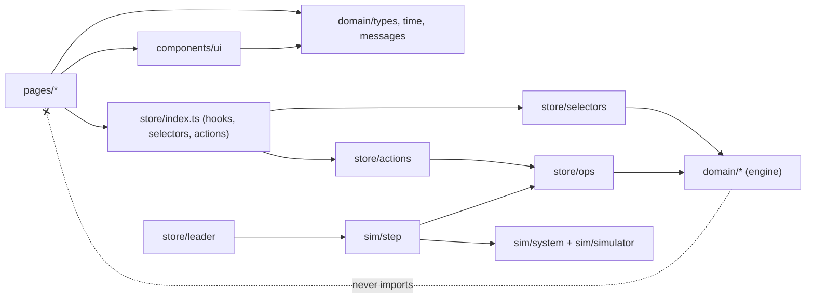
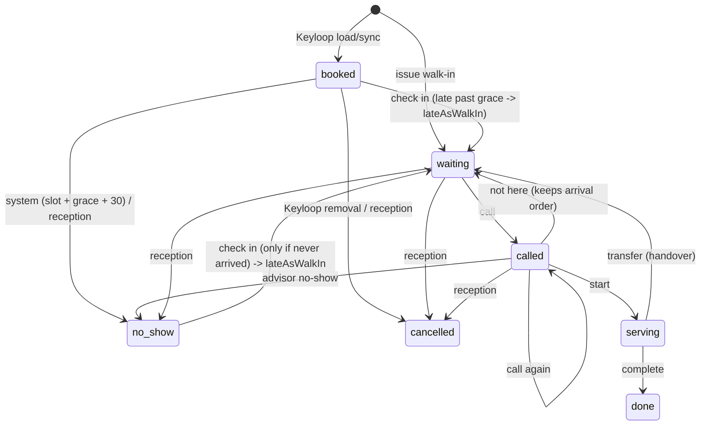
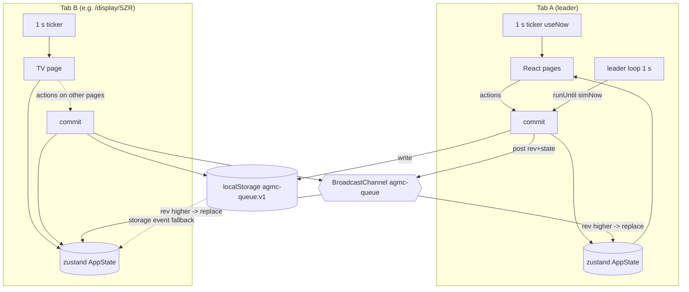

# AGMC Queue: Front-end Architecture (build contract)

Status: v1, 19 Oct 2026. Source of truth for product behaviour and copy: `docs/SPEC.md`. If this file and SPEC.md disagree on copy or layout, SPEC.md wins. This file decides structure, types, ownership and engine behaviour.

This is a front-end-only clickable prototype. There is no backend. All "server" behaviour (validation, queue rules, Keyloop, learning, simulator) runs in the browser, in pure TypeScript modules behind a store.

---

## 0. Decisions at a glance

| Area | Decision | Why |
|---|---|---|
| Framework | React 18 + Vite + TypeScript (strict) | Fixed. |
| Routing | react-router-dom v6 (`createBrowserRouter`) | Fixed. Data routers give us layout routes for guards and the top bar. |
| State | **zustand** (one store holding `AppState`) + our own persistence/sync module | 1 kB, no provider, selector subscriptions via `useSyncExternalStore`, and `getState()/setState()` work outside React (simulator, leader loop, cross-tab sync). We do not use zustand's `persist` middleware: cross-tab sync needs revision-based merge, which is ~100 lines of our own code. |
| Mutations | All writes go through `commit(op)`: clone, run a pure op on the draft, bump `rev`, persist, broadcast | One write path makes validation, audit logging and cross-tab sync impossible to bypass. No immer (not in package list); ops mutate a `structuredClone` draft. |
| Cross-tab | `localStorage` (key `agmc-queue:v1`) + `BroadcastChannel('agmc-queue')`, `storage` event as fallback | TV in another tab updates within ~100 ms of a change. |
| Who runs time-driven logic | Exactly one tab, the **leader**, elected with `navigator.locks` | Prevents two tabs running the simulator twice. When the leader tab closes, the lock passes to another tab automatically. |
| Clock | Simulated Dubai clock derived from an anchor stored in state: `simNow = anchorSimMs + (Date.now() - anchorRealMs) * speed` | All tabs agree on "now" without syncing ticks. Demo opens at 11:00 on 19 Oct 2026 and runs in real time. |
| Re-rendering | One global 1-second ticker (`useNow()`), aligned to second boundaries | Every timer in every tab ticks together. |
| Simulator | Deterministic, seeded, script-driven and level-triggered ("reconcile to now") | The same seed always gives the same day; catch-up after a closed laptop is safe and idempotent. |
| Styling | CSS Modules + CSS custom properties in `src/styles/tokens.css` | Zero extra dependency, scoped per page so parallel engineers never collide, tokens enforce the colour meanings. |
| Charts | Hand-made SVG components inside the dashboard page folder | Only four simple charts; a chart lib would cost ~50-150 kB and fight the house style. |
| Motion | `lenis` (`lenis/react`) for smooth scroll, `motion` for subtle reveals | Fixed by Global project rules. |
| Fonts | Pathway Extreme (Google Fonts, 400/600/700) + JetBrains Mono (500/700) for ticket numbers, usernames, Keyloop refs | Chosen by the designer (see tokens.css / DESIGN.md); clear 0/O and 1/l at 64 px. |
| Tests (dev dependency, recommended) | `vitest` for `src/domain/**` and `src/sim/**` only | The queue engine is the riskiest code; it is pure and cheap to test. No UI tests. |

Runtime packages: `react`, `react-dom`, `react-router-dom`, `zustand`, `lenis`, `motion`.
Dev packages: `vite`, `@vitejs/plugin-react`, `typescript`, `@types/react`, `@types/react-dom`, `vitest` (optional).

---

## 1. Folder structure and ownership

### 1.1 Owners

| Code | Owner | Scope |
|---|---|---|
| **FA** | Foundation A: platform and UI kit | Tooling, app shell, routing, guards, top bar, Lenis, toast, dialog, every shared UI component, styles, assets |
| **FB** | Foundation B: domain, store and simulator | Types, queue engine, learning, KPIs/selectors, store, ops, actions, sync, leader, simulator, mock data |
| **P1** | Sign in | `src/pages/login/**` |
| **P2** | Reception | `src/pages/reception/**` |
| **P3** | Advisor desk | `src/pages/advisor/**` |
| **P4** | Manager overview + Branch dashboard | `src/pages/manager/**` |
| **P5** | Settings | `src/pages/settings/**` |
| **P6** | Waiting-area TV | `src/pages/display/**` |

FA and FB may be the same person. Rules:
- A page engineer only edits files under their own page folder.
- Pages import only from `@/components/ui`, `@/store` (hooks, selectors, actions), `@/domain/types`, `@/domain/time`, `@/domain/messages`. Pages never import from `@/sim/**` or `@/store/ops/**`, and never call `commit()`.
- If a page needs a new selector field, action or UI prop, ask the owner (FA/FB). Until it lands, a page may keep a temporary helper in its own folder, named `*.local.ts`, to be deleted afterwards.
- **Day-0 contract freeze**: FB lands `domain/types.ts`, `domain/messages.ts`, `domain/time.ts`, store hooks, and every selector/action signature (stubs over seed data are fine). FA lands `components/ui/index.ts` with every component listed in section 6 (stubs are fine) plus `routes.tsx` that imports each page's `index.ts`. FA creates one stub `index.ts` per page folder; from then on the page owner owns it.

### 1.2 Tree

```
agmc-queue/
  index.html                         FA  (Google Fonts links, <div id="root">)
  package.json  tsconfig.json  vite.config.ts  .gitignore     FA  (alias "@/" -> src/)
  public/favicon.svg                 FA
  docs/SPEC.md  docs/ARCHITECTURE.md
  src/
    main.tsx                         FA  (calls boot(), renders <App/>)
    vite-env.d.ts                    FA

    app/                             FA
      App.tsx                        providers: ToastProvider, RouterProvider
      boot.ts                        hydrate store, start sync, start leader election, start ticker
      routes.tsx                     route table (section 6.1)
      guards.tsx                     <RequireRole>, <RequireBranchAccess>, <PublicOnly>
      SmoothScroll.tsx               ReactLenis wrapper (reduced-motion aware)
      AppShell.tsx                   TopBar + <Outlet/> inside SmoothScroll, "Loading…" until hydrated
      TopBar.tsx  TopBar.module.css
      BranchPicker.tsx               manager-only, on /reception

    assets/                          FA
      agmc-logo-white.svg            placeholder wordmark until the official file is supplied

    styles/                          FA
      tokens.css                     colours, radii, shadows, font sizes, spacing (section 9)
      base.css                       reset, body, fonts, focus ring, print base
      print.css                      ticket print layout

    components/ui/                   FA  (all exported from index.ts)
      index.ts
      Button.tsx  Chip.tsx  StatusChip.tsx  TypeChip.tsx  AdvisorStateChip.tsx
      KpiTile.tsx  KpiRow.tsx  Card.tsx  PageHeading.tsx  Table.tsx  RowMenu.tsx
      Switch.tsx  Segmented.tsx  PillChoice.tsx  PlaceholderTag.tsx  Banner.tsx
      EmptyState.tsx  LoadingState.tsx  Timer.tsx  TicketNumber.tsx  ProgressBar.tsx  SegmentBar.tsx
      Field.tsx  TextInput.tsx  NumberInput.tsx  Select.tsx  Textarea.tsx  Tooltip.tsx
      Dialog.tsx  toast.tsx (ToastProvider + useToast)  Reveal.tsx  Mono.tsx  Logo.tsx
      *.module.css (one per component)

    domain/                          FB  (pure TS: no React, no storage, no Date.now())
      types.ts                       section 2
      constants.ts                   defaults, break lengths, thresholds
      messages.ts                    ERR, OK, REASON_TEXT, chip/label text (copy from SPEC)
      time.ts                        section 8
      ids.ts                         deterministic id + ticket number helpers
      eligibility.ts                 who can serve what
      queue/
        view.ts                      QueueView builder (snapshot used by pickNext/project)
        pickNext.ts                  "who is next for advisor X"
        project.ts                   full-queue projection (order, est. call times)
        quote.ts                     walk-in quote + per-advisor options
        deskTime.ts                  expected desk minutes (configured -> learned -> advisor pace)
        learning.ts                  learning snapshot from history + today
      kpi.ts                         shared KPI math (promises kept, on-time, averages)
      validation.ts                  settings input validation returning ERR strings
      allocation.ts                  appointment advisor allocation

    store/                           FB
      index.ts                       public surface for pages: hooks, selectors, actions
      state.ts                       AppState type re-export + emptyState
      store.ts                       zustand store, getState(), commit()
      sync.ts                        localStorage + BroadcastChannel + storage event
      leader.ts                      navigator.locks election, leader loop
      clock.ts                       simNow(), ticker, useNow()
      session.ts                     per-tab session (sessionStorage), useSession()
      hooks.ts                       useAppState, useLive
      ops/                           pure mutators on a draft (used by actions AND simulator)
        reception.ts  advisor.ts  settings.ts  keyloop.ts  auth.ts  audit.ts
      actions/                       thin wrappers: authorize via session, then commit(op)
        auth.ts  reception.ts  advisor.ts  settings.ts  keyloop.ts  demo.ts
      selectors/
        common.ts  reception.ts  advisor.ts  manager.ts  dashboard.ts  settings.ts  tv.ts  login.ts

    sim/                             FB
      rng.ts                         mulberry32 + hash-based sub-seeds
      seed/
        branches.ts  advisors.ts  users.ts  services.ts  people.ts (names, vehicles, plates)
      keyloopMock.ts                 invents a day of bookings per branch
      history.ts                     synthesizes 28 days of aggregates
      script.ts                      pre-rolls arrivals, durations, breaks, misses
      system.ts                      always-on jobs: auto no-show, Keyloop syncs, learning refresh
      simulator.ts                   simulated customers + advisors (only when enabled)
      step.ts                        runUntil(draft, toMs): ordered system + sim reconcile
      replay.ts                      buildDemoState(seed): seed + fast-forward 07:30 -> 11:00

    pages/
      login/                         P1
        index.ts  LoginPage.tsx  LoginPage.module.css  BrandPanel.tsx  SignInForm.tsx  DemoAccounts.tsx
      reception/                     P2
        index.ts  ReceptionPage.tsx  ReceptionPage.module.css  ReceptionKpis.tsx
        checkin/  CheckInPanel.tsx  AppointmentTab.tsx  AppointmentRow.tsx  PickAdvisorDialog.tsx
                  WalkInTab.tsx  AdvisorOptionList.tsx  QuoteBox.tsx  TicketIssued.tsx  printTicket.ts
        queue/    QueueCard.tsx  QueueTable.tsx  ChangeAdvisorDialog.tsx  MoveToFrontDialog.tsx
                  NoShowDialog.tsx  CancelTicketDialog.tsx
        advisors/ AdvisorsCard.tsx  AdvisorCard.tsx
        NotArrivedCard.tsx  RecentlyFinishedCard.tsx
      advisor/                       P3
        index.ts  AdvisorDeskPage.tsx  AdvisorDeskPage.module.css  StatusSwitch.tsx  BreakDialog.tsx  AdvisorKpis.tsx
        current/  CurrentCustomerCard.tsx  CallingState.tsx  ServingState.tsx  ReadyNextState.tsx
                  ReadyEmptyState.tsx  AwayState.tsx  CustomerDetailsGrid.tsx  TransferDialog.tsx
        YourLine.tsx  MyDay.tsx
      manager/                       P4
        overview/  index.ts  OverviewPage.tsx  GroupTotals.tsx  BranchCard.tsx  AttentionList.tsx  *.module.css
        dashboard/ index.ts  BranchDashboardPage.tsx  DashboardKpis.tsx
                   charts/  StackedColumnChart.tsx  ColumnChart.tsx  HBarChart.tsx  ChartTooltip.tsx  useChartHover.ts
                   ArrivalsByHourPanel.tsx  AvgWaitByHourPanel.tsx  DeskTimeByServicePanel.tsx  AdvisorsTodayTable.tsx
                   learned/ WaitPromisesPanel.tsx  DeskTimesPanel.tsx
                   ActivityTable.tsx  *.module.css
      settings/                      P5
        index.ts  SettingsPage.tsx  SettingsPage.module.css  SettingsTabs.tsx
        branches/  BranchesTab.tsx  BranchDialog.tsx
        advisors/  AdvisorsTab.tsx  AdvisorDialog.tsx
        services/  ServicesTab.tsx  ServiceTypeDialog.tsx  BrandsCard.tsx
        users/     UsersTab.tsx  UserDialog.tsx
        keyloop/   KeyloopTab.tsx
        audit/     AuditTab.tsx
        demo/      DemoTab.tsx
      display/                       P6
        index.ts  DisplayPage.tsx  DisplayPage.module.css  TvHeader.tsx  NowCalling.tsx
        AtDesks.tsx  NextList.tsx  TvFooter.tsx  ScreenUnavailable.tsx
```

### 1.3 Module dependency rules



`domain/**` and `sim/**` never import React, `window`, `localStorage` or `Date.now()`. Time always comes in as an argument.

---

## 2. Domain model (`src/domain/types.ts`)

```ts
// ---------- primitives ----------
export type EpochMs = number;          // absolute instant (UTC ms). Display always via time.ts (Dubai).
export type DateKey = string;          // 'YYYY-MM-DD' in Dubai time, e.g. '2026-10-19'
export type HHMM = string;             // '07:30' (24h, Dubai)
export type BranchId = string;         // stable slug, never changes: 'szr', 'mc'
export type AdvisorId = string;        // 'adv_omar_szr'
export type VisitId = string;          // 'v_000123' (deterministic counter)
export type ServiceCode = string;      // 'SVC' | 'STD' | 'COL' ...
export type BrandCode = string;        // 'BMW' | 'MINI' | 'BMWi' ...
export type Username = string;         // 'omar.szr'

export type ActionResult<T = undefined> =
  | ({ ok: true } & (T extends undefined ? {} : { data: T }))
  | { ok: false; error: string };      // error is always a string from ERR (SPEC "Problem messages")

// ---------- branch & rules ----------
export interface QueueRules {
  earlyWindowMin: number;     // default 10
  graceMin: number;           // default 15
  walkInCapMin: number;       // default 15
  hardCeilingMin: number;     // default 25, 0 = off
  safetyBufferMin: number;    // default 5
  helpAfterMin: number;       // default 10
  swapAdvisorMin: number;     // default 10, 0 = only at the time told or the ceiling
  onTimeTargetMin: number;    // default 5
  learnDays: number;          // default 28, 0 = configured minutes + fixed 20% margin
  promiseTargetPct: number;   // default 80
}

export type AppointmentAdvisorMode =
  | 'keyloop_else_allocate'   // "Keyloop's advisor if the booking names one, otherwise the system allocates"
  | 'allocate_all'            // "The system allocates every appointment (balanced by skills and load)"
  | 'reception_picks';        // "Left open: reception picks the advisor at check-in"

export interface Branch {
  id: BranchId;
  code: string;               // 'SZR', letters+digits, unique (case-insensitive); used by /display/<code>
  name: string;               // 'Main Branch (SZR)'
  opensAt: HHMM;
  closesAt: HHMM;
  active: boolean;
  appointmentAdvisorMode: AppointmentAdvisorMode;
  rules: QueueRules;
  createdAt: EpochMs;
}

// ---------- advisors ----------
export type DeskType = 'all' | 'appointments_only' | 'walkin_desk' | 'express_desk';
export type AdvisorPresence = 'available' | 'break' | 'offline';      // what the advisor set
export type AdvisorLiveState = 'serving' | 'calling' | 'available' | 'break' | 'offline'; // derived
export type BreakReason = 'Coffee' | 'Prayer' | 'Lunch' | 'Workshop' | 'Meeting';

export interface Advisor {
  id: AdvisorId;
  branchId: BranchId;
  name: string;               // 'Omar Haddad'
  desk: string;               // 'Desk 1' (TV shows "→ Desk 1")
  deskType: DeskType;
  brands: BrandCode[];        // [] = every brand
  services: ServiceCode[];    // [] = every service
  active: boolean;
  presence: AdvisorPresence;
  breakReason: BreakReason | null;
  presenceSince: EpochMs;     // when presence/breakReason last changed
  username: Username | null;  // linked login, or null ("none")
}

// ---------- services & brands ----------
export interface ServiceType {
  code: ServiceCode;          // locked after creation
  name: string;               // 'Service'
  expectedMin: number;        // configured desk minutes (25 / 15 / 8)
  expressLane: boolean;       // Collection = true
  ticketLetter: string | null;// 'C' or null (null = A for appointments / W for walk-ins)
  active: boolean;
}
export type Brand = BrandCode;            // brands are a plain ordered list in state: ['BMW','MINI','BMWi']

// ---------- users & session ----------
export type Role = 'manager' | 'reception' | 'advisor';
export interface User {
  username: Username;         // locked after creation
  name: string;               // 'Aftersales Manager', 'Reception', 'Omar Haddad'
  role: Role;
  branchId: BranchId | null;  // required for reception + advisor, null for manager
  advisorId: AdvisorId | null;// required for advisor
  password: string;           // PROTOTYPE ONLY: plaintext mock credential, see section 10
  canSignIn: boolean;         // false = "Blocked"
  createdAt: EpochMs;
}
export interface Session {    // per tab, sessionStorage; never shared across tabs
  username: Username;
  signedInAt: EpochMs;
}

// ---------- visits (a booking and/or a ticket) ----------
export type VisitKind = 'appointment' | 'walk_in';
export type VisitStatus = 'booked' | 'waiting' | 'called' | 'serving' | 'done' | 'no_show' | 'cancelled';
export type AdvisorSource =
  | 'keyloop'     // "(booked in Keyloop)"
  | 'allocated'   // "(allocated)"
  | 'reception'   // "(picked at reception)" - appointment advisor picked/changed at reception
  | 'issue'       // walk-in: advisor chosen when the ticket was issued
  | 'reassigned'  // walk-in moved with "Change advisor" -> "Assigned → <name>"
  | 'handover';   // transferred by a colleague      -> "Assigned → <name>"

export interface Customer {
  name: string | null;        // null -> "Walk-in customer"
  mobile: string;             // '+971 50 123 4567' ('' allowed for walk-ins)
  plate: string;              // 'Dubai X 75542'
  vehicle: string;            // 'X6 M60i' (brand shown separately)
}

export interface Booking {      // only for kind === 'appointment'
  keyloopRef: string;           // 'KL-SZR-1019-030'
  slotAt: EpochMs;
  keyloopAdvisorId: AdvisorId | null; // advisor named by Keyloop, if any
  importedAt: EpochMs;
  syncId: string;               // KeyloopSync.id that created/last updated it
}

export interface Quote {        // what reception told the customer (walk-ins and appointments)
  issuedAt: EpochMs;
  advisorId: AdvisorId | null;  // null = "Whoever is free first"
  forecastMin: number;          // raw projection minutes (int)
  marginPct: number;            // learned or fixed 20
  quotedMin: number;            // "About N min" (ceil to 5, min 5)
  toldBy: EpochMs;              // issuedAt + quotedMin -> "called by HH:MM"
  sampleSize: number;           // walk-ins learned from
  afterClosing: boolean;        // est. finish after branch close
}

export interface CallEvent { at: EpochMs; advisorId: AdvisorId; reason: NextReasonCode }

export interface Visit {
  id: VisitId;
  branchId: BranchId;
  date: DateKey;
  kind: VisitKind;
  status: VisitStatus;
  ticketNo: string | null;      // 'A-014' / 'W-018' / 'C-004', assigned at check-in/issue
  customer: Customer;
  brand: BrandCode;
  serviceCode: ServiceCode;
  booking: Booking | null;
  advisorId: AdvisorId | null;  // whose line it is in; null = "Whoever is free first" / "no advisor yet"
  advisorSource: AdvisorSource | null;
  lateAsWalkIn: boolean;        // appointment that arrived after slot + grace (or after auto no-show)
  arrivedAt: EpochMs | null;    // check-in / issue time
  quote: Quote | null;
  receptionNote: string;        // walk-in "Note" field
  priorNotes: string[];         // "Notes the reception or earlier visits left" (mock)
  visitNote: string;            // advisor "Note for this visit", saved on Complete
  bump: { at: EpochMs; by: Username; reason: string } | null;            // Move to front
  handover: { at: EpochMs; fromAdvisorId: AdvisorId; toAdvisorId: AdvisorId | null; reason: string } | null;
  calls: CallEvent[];           // current call cycle (cleared by "Not here" and by transfer)
  firstCalledAt: EpochMs | null;// first call ever (used for promises kept, on-time, wait charts)
  calledBy: AdvisorId | null;   // advisor of the current call
  startedAt: EpochMs | null;    // "WITH YOU SINCE"
  servedBy: AdvisorId | null;
  endedAt: EpochMs | null;      // done / no_show / cancelled time
  endReason: string;            // cancel reason, no-show source, etc.
}

// Derived (never stored): queuesAsWalkIn(v) = v.kind === 'walk_in' || v.lateAsWalkIn

// ---------- next-customer reasons ----------
export type NextReasonCode =
  | 'handover'            // Handed over to you by a colleague
  | 'ceiling'             // Walk-in at the hard ceiling
  | 'own_appt_due'        // Your appointment is due
  | 'cover_appt'          // Another advisor's appointment is waiting
  | 'bumped'              // Moved to the front by reception
  | 'over_cap'            // Walk-in over the wait cap
  | 'cover_walkin'        // Covering a colleague's walk-in so we keep the time we told them
  | 'fits'                // Walk-in that fits before your next appointment
  | 'early_appt';         // Appointment arrived early

// ---------- audit ----------
export type Who = Username | 'simulator' | 'system';
export type AuditWhat =
  | 'sign in' | 'sign out' | 'check in' | 'walk in' | 'call' | 'call again' | 'start' | 'not here'
  | 'complete' | 'transfer' | 'assign' | 'bump' | 'no show' | 'cancel' | 'advisor status'
  | 'keyloop sync' | 'keyloop load' | 'allocate' | 'settings' | 'simulator';
export interface AuditEntry {
  id: string;
  at: EpochMs;
  branchId: BranchId | null;    // null for global settings
  who: Who;
  what: AuditWhat;
  detail: string;               // e.g. "W-016 → Daniel Costa (Desk 3): Walk-in that fits before your next appointment"
}

// ---------- Keyloop (mock) ----------
export interface KeyloopDayStatus {
  date: DateKey;
  loadedAt: EpochMs;
  count: number;
  namedByKeyloop: number;
  allocated: number;
  open: number;                 // no advisor yet
}
export interface KeyloopSync {
  id: string;
  at: EpochMs;
  branchId: BranchId;
  source: 'mock';
  kind: 'nightly' | 'intraday' | 'manual_tomorrow' | 'manual_today';
  date: DateKey;
  added: number; updated: number; removed: number;
  note: string;                 // "63 bookings for 2026-10-19"
}
export interface KeyloopState {
  source: 'mock';
  nightlyLoadAt: HHMM;          // '22:00'
  intradayEveryMin: 10;
  lastIntradayAt: EpochMs | null;
  days: Record<BranchId, Record<DateKey, KeyloopDayStatus>>;
  history: KeyloopSync[];       // newest first, cap 200
}

// ---------- learning ----------
export interface ServiceAgg { visits: number; totalMin: number; byBrand: Record<BrandCode, { visits: number; totalMin: number }> }
export interface WalkInOutcome { forecastMin: number; quotedMin: number; waitMin: number } // wait = arrival -> first call
export interface DailyAgg {
  date: DateKey;
  perService: Record<ServiceCode, ServiceAgg>;
  perAdvisor: Record<AdvisorId, Record<ServiceCode, { visits: number; totalMin: number }>>;
  walkIns: WalkInOutcome[];
}
export interface LearningHistory { branchId: BranchId; days: DailyAgg[] }   // synthesized: 28 days before today

export interface LearningSnapshot {
  branchId: BranchId;
  computedAt: EpochMs;          // refreshed every 10 sim minutes
  windowDays: number;           // rules.learnDays at compute time; 0 = off
  services: Record<ServiceCode, {
    configuredMin: number;
    measuredMin: number | null;
    visits: number;
    nowUsingMin: number;        // shrunk estimate (section 3.6)
    byBrand: Record<BrandCode, { measuredMin: number; visits: number }>;
  }>;
  advisors: Record<AdvisorId, Record<ServiceCode, { visits: number; theirMin: number; teamMin: number; factor: number }>>;
  quote: {
    sampleSize: number;
    marginPct: number;          // e.g. 32
    keptPct: number | null;     // share called by the time told
    driftTypicalMin: number;    // median(wait - forecast)
    driftP80Min: number;        // 80th pct of |wait - forecast|
    histogram: [number, number, number, number, number, number]; // 10+ sooner, 5–10 sooner, 0–5 sooner, 1–5 later, 5–10 later, 10+ later
    brokenAvgOverMin: number | null; // "broken ones ran 8 min over"
  };
}

// ---------- simulator ----------
export type Driver = 'sim' | 'person';
export interface VisitSimPlan {           // per booked appointment
  arrivalOffsetMin: number | null;        // relative to slot; null = never arrives
  receptionPick: AdvisorId | 'first_free' | null; // for open bookings: who the simulated receptionist picks
}
export interface ServicePlan {            // per visit, applied once called (keyed by VisitId or WalkInPlan.id)
  deskMin: number;                        // actual desk time
  walkSec: number;                        // call -> customer reaches desk
  missesCall: boolean;                    // needs "Call again", then "Not here" once
  transferAtFrac: number | null;          // e.g. 0.4 -> transfer to "Next free advisor" at 40% of deskMin
}
export interface WalkInPlan {
  id: string; branchId: BranchId; at: EpochMs;
  serviceCode: ServiceCode; brand: BrandCode; customer: Customer; note: string;
  issuedVisitId: VisitId | null;          // set when the simulator issued it
}
export interface BreakPlan { id: string; advisorId: AdvisorId; at: EpochMs; reason: BreakReason; durationMin: number; startedAt: EpochMs | null; endedAt: EpochMs | null }
export interface RosterPlan { advisorId: AdvisorId; presentFrom: EpochMs | null; presentUntil: EpochMs | null } // null from = offline all day
export interface SameDayBookingPlan { id: string; branchId: BranchId; bookedAt: EpochMs; kind: 'add' | 'move' | 'cancel'; payload: unknown }

export interface SimScript {
  seed: number;
  appointments: Record<VisitId, VisitSimPlan>;
  service: Record<string, ServicePlan>;
  walkIns: WalkInPlan[];
  breaks: BreakPlan[];
  roster: RosterPlan[];
  sameDay: SameDayBookingPlan[];
}

export interface SimulatorSettings {
  enabled: boolean;
  seed: number;                            // default 20261019
  drivers: Record<AdvisorId, Driver>;      // "Who drives each advisor"
  demoStart: HHMM;                         // '11:00'
  stepSec: number;                         // live 1, replay/catch-up 5
}

export interface SimClock { anchorSimMs: EpochMs; anchorRealMs: number; speed: number } // speed 1 (dev: ?speed=10)

// ---------- whole state ----------
export interface AppState {
  schemaVersion: 1;
  rev: number;                             // +1 per commit
  writerId: string;                        // tab id of last writer (tie-break)
  today: DateKey;                          // '2026-10-19'
  clock: SimClock;
  branches: Record<BranchId, Branch>;
  branchOrder: BranchId[];
  advisors: Record<AdvisorId, Advisor>;
  services: Record<ServiceCode, ServiceType>;
  serviceOrder: ServiceCode[];
  brands: Brand[];
  users: Record<Username, User>;
  visits: Record<VisitId, Visit>;
  counters: Record<string, number>;        // `${branchId}:${date}:${letter}` -> last ticket number; 'seq' for ids
  audit: AuditEntry[];                     // newest first, cap 2000
  keyloop: KeyloopState;
  history: Record<BranchId, LearningHistory>;
  learning: Record<BranchId, LearningSnapshot>;
  simulator: SimulatorSettings;
  script: SimScript;
  lastProcessedAt: EpochMs;                // leader catch-up cursor
}
```

### 2.1 Visit state machine



### 2.2 Ticket numbering
`letter = service.ticketLetter ?? (queuesAsWalkIn ? 'W' : 'A')`; number = `++counters[branchId:date:letter]`, padded to 3 digits. Late appointments get W (they queue as walk-ins). Numbers restart per branch, day and letter.

---

## 3. Queue engine (`src/domain/queue/*`, `src/domain/eligibility.ts`)

All functions are pure. `now` is passed in. All minute math uses `(a - b) / 60000`.

### 3.1 Building blocks

```ts
// eligibility.ts
export function queuesAsWalkIn(v: Visit): boolean;
export function canServe(a: Advisor, v: Visit, svc: ServiceType, mode: 'own' | 'cover'): boolean;
//  - a.active, a.branchId === v.branchId, presence !== 'offline'
//  - brand: a.brands empty or includes v.brand; service: a.services empty or includes v.serviceCode
//  - deskType:
//      'all'               -> anything
//      'appointments_only' -> appointments that do NOT queue as walk-in (own or cover)
//      'walkin_desk'       -> walk-ins/late appts; appointments only in mode 'cover'
//      'express_desk'      -> only services with expressLane === true (any kind)
export function presentAdvisors(s: AppState, branchId: BranchId): Advisor[];   // active && presence !== 'offline'

// view.ts: snapshot used by the engine (lets project.ts run "virtual time")
export interface QueueView {
  branch: Branch;
  services: Record<ServiceCode, ServiceType>;
  advisors: Advisor[];                               // active advisors of the branch
  waiting: Visit[];                                  // status 'waiting' (+ virtual items in projection)
  upcomingAppts: Visit[];                            // booked/waiting appts, not yet called, slot today
  busyUntil: Record<AdvisorId, EpochMs>;             // estimateFreeAt per advisor (Infinity = offline)
  liveState: Record<AdvisorId, AdvisorLiveState>;
  deskMin: (serviceCode: ServiceCode, brand: BrandCode, advisorId: AdvisorId | null) => number;
}
export function buildQueueView(s: AppState, branchId: BranchId, now: EpochMs): QueueView;

export function waitStartAt(v: Visit): EpochMs;   // walk-in-like: arrivedAt; appointment: max(slotAt, arrivedAt)
export function waitedMin(v: Visit, now: EpochMs): number;   // floor, >= 0; for walk-ins: since arrival
export function isDue(v: Visit, rules: QueueRules, now: EpochMs): boolean; // appt: now >= slot - earlyWindow
export function advisorLiveState(s: AppState, advisorId: AdvisorId): AdvisorLiveState;
//   called visit with calledBy=me -> 'calling'; serving with servedBy=me -> 'serving'; else presence
export function currentVisitOf(s: AppState, advisorId: AdvisorId): Visit | null;  // status called|serving
export function estimateFreeAt(s: AppState, advisorId: AdvisorId, now: EpochMs): EpochMs;
//   available+idle: now; serving: max(now + 1min, startedAt + deskMin); calling: now + walk(1 min) + deskMin;
//   break: max(now + 1min, presenceSince + BREAK_MIN[reason]); offline/inactive: Infinity
export function nextAppointmentFor(view: QueueView, advisorId: AdvisorId, t: EpochMs): Visit | null;
//   earliest upcoming appointment (booked or waiting, not lateAsWalkIn) with advisorId === me and slot >= t - grace
export function fitsBefore(view: QueueView, advisorId: AdvisorId, v: Visit, t: EpochMs): boolean;
//   next = nextAppointmentFor(...); !next || t + 1 + deskMin(v, me) + safetyBufferMin <= next.slotAt (minutes)
```

Constants (`constants.ts`): `CALL_TO_START_MIN = 1`, `BREAK_MIN = { Coffee: 15, Prayer: 15, Lunch: 45, Workshop: 30, Meeting: 30 }`, `AUTO_NO_SHOW_AFTER_GRACE_MIN = 30`, `NEAR_CAP_MIN = 3` (amber), `FIXED_MARGIN_PCT = 20`, `PRIOR_WEIGHT_VISITS = 5`, `LONG_WAIT_MIN = 30`, `FRESH_CALL_SEC = 20`, `AUDIT_CAP = 2000`.

### 3.2 `pickNext`: who is next for advisor X

```ts
export interface NextPick { visitId: VisitId; reason: NextReasonCode; covering: boolean }
export function pickNext(view: QueueView, advisorId: AdvisorId, t: EpochMs, exclude?: ReadonlySet<VisitId>): NextPick | null;
```

Called only for an advisor who is `available` and idle (no current visit). Candidates are `view.waiting` minus `exclude`, filtered by `canServe`. Evaluate the tiers below **in order**; the first tier with a candidate wins; inside a tier use the stated tie-break, then ticket number. Tier order equals the order of SPEC "Why this customer is next".

| # | Code | Candidate condition (for me = advisor X) | Assignment check | Fit check | Tie-break |
|---|---|---|---|---|---|
| 1 | `handover` | `handover.toAdvisorId === me`, or `handover.toAdvisorId === null` ("next free", kept at the front) | to me, or to anyone | no | handover.at |
| 2 | `ceiling` | queues as walk-in, `hardCeilingMin > 0`, `waitedMin >= hardCeilingMin` | anyone eligible | no | longest wait |
| 3 | `own_appt_due` | appointment (not lateAsWalkIn), arrived, `isDue`, `advisorId === me` **or** `advisorId === null` | mine or unassigned | no | slot, then arrival |
| 4 | `cover_appt` | appointment, arrived, `advisorId = Y ≠ me`, `t >= slot`, and either Y is `break`/`offline`, or Y is `calling`/`serving` and `t >= slot + helpAfterMin` | Y's, eligible with mode `'cover'` | no | slot |
| 5 | `bumped` | queues as walk-in, `bump !== null` | anyone eligible | no | bump.at |
| 6 | `over_cap` | queues as walk-in, `waitedMin >= walkInCapMin` | mine or unassigned | no | arrival |
| 7 | `cover_walkin` | queues as walk-in, `advisorId = Y ≠ me`, and (`t >= quote.toldBy`, or `swapAdvisorMin > 0 && busyUntil[Y] - t >= swapAdvisorMin`) | Y's | **yes** | arrival |
| 8 | `fits` | queues as walk-in | mine or unassigned | **yes** | arrival |
| 9 | `early_appt` | appointment arrived, `advisorId === me` or null, not yet in early window, and tiers 1–8 found nothing for me | mine or unassigned | no | slot |

Notes:
- `covering = true` for tiers 4 and 7 (and for 2/5 when the visit's advisor is someone else). Used for "est. 12:41 · Omar Haddad covering" and "Omar Haddad may cover".
- A walk-in assigned to another advisor is only reachable by me through tiers 2, 5 or 7.
- Tiers 2, 5, 6 skip the fit check by design (cap/ceiling/bump outrank not-yet-due appointments); a due appointment still beats 5 and 6 because tier 3 is evaluated first.
- Unassigned due appointments (reception chose "Whoever is free first") use tier 3; the advisor who calls becomes `servedBy`.
- Reason text: `REASON_TEXT[code]` in `messages.ts`, verbatim from SPEC.

### 3.3 `projectQueue`: order and estimated call times

```ts
export interface ProjectedCall {
  visitId: VisitId;
  position: number;                // 1-based, in call order
  advisorId: AdvisorId | null;     // projected caller; null = "No advisor available" before horizon
  estCallAt: EpochMs | null;
  reason: NextReasonCode | null;
  covering: boolean;               // projected caller !== visit.advisorId (and visit.advisorId !== null)
}
export interface Projection {
  branchId: BranchId;
  at: EpochMs;
  order: ProjectedCall[];          // all waiting visits; unplaceable ones last, by arrival
  byVisit: Record<VisitId, ProjectedCall>;
  advisorFreeAt: Record<AdvisorId, EpochMs>;
}
export function projectQueue(s: AppState, branchId: BranchId, now: EpochMs): Projection;  // memoized
export function projectQueueView(view: QueueView, now: EpochMs, extra?: Visit[]): Projection; // used by quote.ts
```

Algorithm (discrete event simulation, bounded):
1. `freeAt[a] = view.busyUntil[a]` for present advisors whose live state is not offline.
2. Add **virtual arrivals**: every booked (not arrived) appointment with `slot >= now - grace` is assumed to arrive at `slot`; it becomes visible to `pickNext` only once virtual time `t >= slot`. Virtual arrivals are not output, but they occupy advisors, which keeps walk-in quotes honest.
3. Loop: pick advisor `a` with the smallest `freeAt` (ties: desk order). Set `t = freeAt[a]`. `pick = pickNext(viewAt(t), a, t, placed)`.
   - If pick: record `{advisorId: a, estCallAt: t, reason}` (real visits only), add to `placed`, set `freeAt[a] = t + CALL_TO_START_MIN + deskMin(visit, a)`; if the visit was a's appointment, `nextAppointmentFor` moves on.
   - If none: `freeAt[a] = min(next interesting time for a)`, where interesting times are the next virtual arrival slot, next `slot - earlyWindow`, next cap/ceiling/toldBy crossing of any waiting walk-in, or `t + 5 min`, whichever is earliest.
4. Stop when every real waiting visit is placed, `t > closesAt + 3 h`, or 600 iterations. Unplaced visits get `advisorId: null, estCallAt: null` (clay "No advisor available").

Memoization: cache key `${rev}|${branchId}|${floor(now / 5000)}`; a single cache entry per branch. Cost is about 10 advisors × 60 visits × a few hundred iterations, well under 2 ms.

### 3.4 Wait quote (`quote.ts`)

```ts
export interface WalkInQuoteInput { branchId: BranchId; serviceCode: ServiceCode; brand: BrandCode; advisorId: AdvisorId | null }
export interface WalkInQuote {
  forecastMin: number; marginPct: number; quotedMin: number; calledBy: EpochMs;
  seenBy: AdvisorId | null;        // chosen advisor, or null = "The first free advisor"
  sampleSize: number; learningOff: boolean;
  afterClosing: boolean;           // calledBy + deskMin > closesAt
  longWait: boolean;               // quotedMin >= 30
}
export function quoteWalkIn(s: AppState, input: WalkInQuoteInput, now: EpochMs): WalkInQuote | null; // null = nobody can take it

export interface WalkInOptionRow { advisorId: AdvisorId | null; name: string; desk: string | null; quote: WalkInQuote; soonest: boolean }
export interface WalkInOptions {
  rows: WalkInOptionRow[];         // eligible present advisors sorted by quotedMin then desk; last row = "Whoever is free first"
  defaultAdvisorId: AdvisorId | null; // soonest
  presentCount: number;
  noneCanTake: boolean;            // -> "No advisor can take this now" / "<n> advisor(s) present; none handles this brand/service."
}
export function walkInOptions(s: AppState, branchId: BranchId, serviceCode: ServiceCode, brand: BrandCode, now: EpochMs): WalkInOptions;

export function quoteForAppointmentCheckIn(s: AppState, visitId: VisitId, advisorId: AdvisorId | null, now: EpochMs): Quote;
export function roundQuote(min: number): number;   // max(5, ceil(min / 5) * 5)
export function marginFor(snapshot: LearningSnapshot | undefined, rules: QueueRules): { marginPct: number; sampleSize: number; learningOff: boolean };
```

Math:
- `forecastMin = max(0, round((estCallAt - now) / 60000))` from `projectQueueView(view, now, [hypothetical])`, where the hypothetical walk-in has `arrivedAt = now` and `advisorId = input.advisorId`.
- `marginPct = learnDays === 0 || sampleSize < 5 ? 20 : snapshot.quote.marginPct`.
- `quotedMin = roundQuote(forecastMin * (1 + marginPct / 100))`. Check: 11 × 1.32 = 14.5 → 15; 5 × 1.04 → 10; 15 × 1.04 → 20.
- `calledBy = now + quotedMin` minutes. Display "called by HH:MM" (minutes ceiled).
- Margin learning: for each historical walk-in, `r = waitMin / max(forecastMin, 1)`; `marginPct = clamp(round((quantile(r, promiseTargetPct / 100) - 1) * 100), 0, 100)`.
- Quote-box grey line (built by the selector): `Forecast {f} min + {m}% margin, so about {target/10} in 10 walk-ins are called sooner than told · learned from {n} walk-ins over the last {days} days`. When learning is off: `Forecast {f} min + 20% margin (learning is off for this branch)`.

### 3.5 Learning (`learning.ts`)

```ts
export function computeLearning(history: LearningHistory, todayDone: Visit[], branch: Branch, services: Record<ServiceCode, ServiceType>, now: EpochMs): LearningSnapshot;
```
Recomputed by the system job every 10 simulated minutes and immediately when the branch's `learnDays` or a service's `expectedMin` changes. Window = the last `learnDays` days of history plus today's finished visits. The examples chips ("forecast 5′ → told 10′" …) are computed with `roundQuote(f * (1 + margin))` for f = 5, 15, 30, 60.

### 3.6 Desk time (`deskTime.ts`)

```ts
export function expectedDeskMin(s: AppState, branchId: BranchId, serviceCode: ServiceCode, brand: BrandCode, advisorId: AdvisorId | null): number;
```
- `learnDays === 0`: `service.expectedMin`.
- Else `nowUsing = (expectedMin * K + measuredMin * visits) / (K + visits)`, K = 5. Check: (25·5 + 33·17) / 22 = 31.2 → 31′ (matches SPEC).
- With an advisor: multiply by `factor = shrink(theirMin / teamMin, theirVisits, K)` where `shrink(x, n, K) = (1·K + x·n) / (K + n)`.
- "Now using" turns clay when `|nowUsing - configured| >= 3`.

### 3.7 Allocation (`allocation.ts`)

```ts
export function allocateAppointments(s: AppState, branchId: BranchId, date: DateKey, visitIds: VisitId[]): Record<VisitId, AdvisorId | null>;
```
Greedy by slot: eligible advisors (`canServe` own, deskType `all` or `appointments_only`, roster present at slot), excluding those with an overlapping appointment (`slot` to `slot + deskMin`); choose the lowest count of appointments that day, tie by desk order. Returns null when none fit ("open"). Used by Keyloop load/sync (`allocate` audit entries, who `system`). Mode `keyloop_else_allocate` keeps `keyloopAdvisorId` when present (`advisorSource: 'keyloop'`); `allocate_all` ignores it; `reception_picks` leaves all open.

### 3.8 Shared chip/label helpers (`store/selectors/common.ts`)

```ts
export type Tone = 'grey' | 'green' | 'darkGreen' | 'amber' | 'clay' | 'blue' | 'outline';
export interface ChipSpec { text: string; tone: Tone }
export function statusChip(status: VisitStatus): ChipSpec;                 // Booked/Waiting/Called/With advisor/Done/No-show/Cancelled
export function typeChip(v: Visit): ChipSpec;                              // "Appointment 12:30" green / "Walk-in" outline / "Late appt 11:00 · walk-in" amber
export function appointmentArrivalChip(v: Visit, rules: QueueRules, now: EpochMs): ChipSpec;
//   "in 28 min" grey (> earlyWindow before) / "Due now" green (slot-early..slot) / "4 min late" amber (<= grace)
//   / "18 min late · walk-in" clay (> grace) / "Missed · joins as walk-in" clay (no_show, never arrived)
export function notArrivedChip(v: Visit, rules: QueueRules, now: EpochMs): ChipSpec;   // "in 15′" / "4′ late" / "missed"
export function advisorStateChip(state: AdvisorLiveState): ChipSpec;      // Serving/Calling/Available/On break/Offline
export function advisorSourceLabel(v: Visit): string;                      // "(booked in Keyloop)" ... "no advisor yet"
export function deskTypeLabel(t: DeskType): string;                        // All customers / Appointments only / Walk-in desk / Express desk
export function advisorSubtitle(a: Advisor): string;                       // "Desk 6 · Walk-in desk" / "Desk 7 · MINI" / "Desk 1"
```

---

## 4. Store API

### 4.1 Hooks and core (`store/index.ts`)

```ts
export function useAppState<T>(selector: (s: AppState) => T, equality?: (a: T, b: T) => boolean): T;
export function useNow(): EpochMs;                                  // sim Dubai "now", re-renders every second
export function useLive<T>(compute: (s: AppState, now: EpochMs) => T, deps?: unknown[]): T;
//   recomputes on store change and on each tick; returns the previous object if shallow-equal
export function useHydrated(): boolean;                             // false -> show "Loading…"
export function useSession(): SessionInfo | null;
export interface SessionInfo { user: User; branch: Branch | null; advisor: Advisor | null; home: string }
export function homeFor(user: User): '/manager' | '/reception' | '/advisor';
export function simNow(): EpochMs;                                  // non-React
```

`commit` (internal, FB only):
```ts
export function commit<T>(op: (draft: AppState, ctx: OpCtx) => ActionResult<T>, who: Who): ActionResult<T>;
export interface OpCtx { now: EpochMs; who: Who; audit(e: Omit<AuditEntry, 'id' | 'at' | 'who'>): void }
```
1. If `localStorage` holds a higher `rev` than memory, adopt it first.
2. `draft = structuredClone(state)`; run `op`. On `ok:false`, drop the draft (no state change, no audit).
3. On ok: `rev++`, `writerId = tabId`, `set(draft)`, write localStorage (throttled to 4 writes/s, always flushed on `pagehide`), post `{type:'rev', rev}` plus the state on BroadcastChannel.

### 4.2 Actions

Every action is a plain function that reads the tab's session for authorization and `who`, then commits an op. All return `ActionResult`. Pages show toasts with `toast.fromResult(result, OK.x)`. Actions never toast.

Common auth errors that any signed-in action may return: `Please sign in again.` (no session or user blocked or removed), `Your role cannot open this`, `Not your branch`, `This account is not linked to an advisor`.

**Auth (`actions/auth.ts`)**

| Action | Signature | Errors | Notes |
|---|---|---|---|
| Sign in | `signIn(username: string, password: string): ActionResult<{ home: string }>` | Wrong username or password | Blocked users get the same message. Audit `sign in`. Advisor: `drivers[id]='person'`, presence → available if offline. |
| Sign out | `signOut(): ActionResult` | — | Audit `sign out`. Advisor: driver back to `'sim'`. |

**Reception (`actions/reception.ts`)** (reception: own branch; manager: any branch)

| Action | Signature | Errors | Success toast |
|---|---|---|---|
| Check in appointment | `checkInAppointment(visitId: VisitId, advisor?: AdvisorId \| 'first_free'): ActionResult<{ visitId: VisitId }>` | Only a booked appointment can be checked in · This appointment is not for today · Advisor not in this branch | (switches to Ticket issued) |
| Change advisor of a booking (before check-in) | `setBookingAdvisor(visitId: VisitId, advisorId: AdvisorId): ActionResult` | Only a waiting or booked ticket can be moved · Advisor not in this branch | Advisor changed |
| Issue walk-in | `issueWalkIn(input: { branchId: BranchId; serviceCode: ServiceCode; brand: BrandCode; advisorId: AdvisorId \| null; customer: Customer; note: string }): ActionResult<{ visitId: VisitId }>` | Unknown service type · Advisor not in this branch · No advisor can take this now | (switches to Ticket issued) |
| Change advisor (queue row) | `changeAdvisor(visitId: VisitId, advisorId: AdvisorId \| null, reason: string): ActionResult` | Only a waiting or booked ticket can be moved · Advisor not in this branch | Advisor changed |
| Move to front | `moveToFront(visitId: VisitId, reason: string): ActionResult` | Give a reason — every override is logged · Appointments keep their slot — change its advisor instead · Only a waiting ticket can be moved to the front | Moved to the front |
| Mark no-show | `markNoShow(visitId: VisitId): ActionResult` | This ticket can no longer be marked as a no-show | Marked as no-show |
| Cancel ticket | `cancelTicket(visitId: VisitId, reason: string): ActionResult` | This ticket can no longer be cancelled | Ticket cancelled |

Rules: check-in sets `arrivedAt = now`, `lateAsWalkIn = now > slot + grace || status === 'no_show'`, issues the ticket number, stores a `Quote` (section 3.4), audit `check in`. When the visit has no advisor and `advisor` is not given, the page must open the pick-advisor dialog first (the action treats missing as `'first_free'`). Picking an advisor sets `advisorSource: 'reception'`. `changeAdvisor` keeps `arrivedAt` (place by arrival) and sets `advisorSource: 'reassigned'` for walk-ins or `'reception'` for appointments; audit `assign`. `moveToFront` audits `bump` with the reason. No-show is allowed from booked/waiting/called; cancel from booked/waiting/called.

**Advisor (`actions/advisor.ts`)** (the advisor role acts on its own `advisorId`; the simulator calls the same ops with `who: 'simulator'`)

| Action | Signature | Errors | Success toast |
|---|---|---|---|
| Set available | `setAvailable(): ActionResult` | Finish or transfer your current customer first | You're available |
| Start break | `startBreak(reason: BreakReason): ActionResult` | Finish or transfer your current customer first | Enjoy your break |
| Go offline | `goOffline(): ActionResult` | Finish or transfer your current customer first | Signed off the queue |
| Call next | `callNext(): ActionResult<{ visitId: VisitId; ticketNo: string }>` | Set yourself Available first · Finish your current customer first · Nobody is waiting for you right now | `Calling ${ticketNo}` |
| Call again | `callAgain(): ActionResult` | No customer in that state at your desk | Called again |
| Start | `startService(): ActionResult` | No customer in that state at your desk | Started |
| Not here | `notHere(): ActionResult` | No customer in that state at your desk | Back in the queue |
| No-show (calling) | `advisorNoShow(): ActionResult` | No customer in that state at your desk · This ticket can no longer be marked as a no-show | Marked as no-show |
| Complete | `complete(note?: string): ActionResult` | No customer in that state at your desk | Done — nice work |
| Transfer | `transfer(to: AdvisorId \| null, reason: string): ActionResult` | No customer in that state at your desk · Advisor not in this branch | Transferred |

`callNext` runs `pickNext(buildQueueView(s, branch, now), me, now)` and stores the reason on the `CallEvent`; audit `call` with detail `${ticket} → ${name} (${desk}): ${REASON_TEXT[reason]}`. `setAvailable` while already available is a no-op `ok`. Calling and serving states are what "current customer" means for the status errors. Transfer resets `calls`, `startedAt`, sets `status: 'waiting'`, `handover`, `advisorId = to`, `advisorSource: 'handover'`.

**Settings (`actions/settings.ts`)** (manager only; every success writes an audit `settings` entry)

| Action | Signature | Errors | Success toast |
|---|---|---|---|
| Save branch | `saveBranch(input: BranchInput, id?: BranchId): ActionResult<{ id: BranchId }>` | A branch with that code exists · Code: letters and digits only · Opening hours must be HH:MM and open before close · Reception password: at least 8 characters · That username is taken | Branch added / Saved |
| Save advisor | `saveAdvisor(input: AdvisorInput, id?: AdvisorId): ActionResult<{ id: AdvisorId }>` | Advisor not in this branch · This advisor is serving someone — move them after · Username: 3–64 of a-z 0-9 . _ - · That username is taken · Password: at least 8 characters | Advisor added / Saved |
| Save service type | `saveServiceType(input: ServiceTypeInput, code?: ServiceCode): ActionResult` | A service type with that code exists · Code: letters and digits only | Saved |
| Save brands | `saveBrands(text: string): ActionResult` | Keep at least one brand | Brands saved |
| Save user | `saveUser(input: UserInput, username?: Username): ActionResult` | Username: 3–64 of a-z 0-9 . _ - · That username is taken · Reception and advisor accounts belong to a branch · Pick the advisor this login belongs to · Password: at least 8 characters · You cannot remove your own manager access | Saved |

```ts
export interface BranchInput { code: string; name: string; opensAt: HHMM; closesAt: HHMM; active: boolean;
  appointmentAdvisorMode: AppointmentAdvisorMode; rules: QueueRules; receptionPassword?: string } // new only -> creates reception.<code lowercased>
export interface AdvisorInput { name: string; branchId: BranchId; desk: string; deskType: DeskType; brands: BrandCode[];
  services: ServiceCode[]; active: boolean; loginUsername?: string; loginPassword?: string }
export interface ServiceTypeInput { code: string; name: string; expectedMin: number; ticketLetter: string | null; expressLane: boolean; active: boolean }
export interface UserInput { username: string; name: string; role: Role; branchId: BranchId | null; advisorId: AdvisorId | null;
  password?: string /* blank = keep */; canSignIn: boolean }
```
"This advisor is serving someone — move them after" fires when changing branch or deactivating an advisor who is calling or serving. "You cannot remove your own manager access" fires when the signed-in manager changes their own role or blocks themselves. Rule numbers are integers ≥ 0 (the dialog clamps).

**Keyloop (`actions/keyloop.ts`)**

| Action | Signature | Errors | Success toast |
|---|---|---|---|
| Nightly load time | `setNightlyLoadTime(hhmm: string): ActionResult` | Time must be HH:MM | Saved |
| Load tomorrow now | `loadTomorrow(): ActionResult<{ count: number }>` | — | Tomorrow's bookings loaded |
| Sync today | `syncToday(branchId: BranchId): ActionResult<KeyloopSync>` | — | Today synced |

**Demo (`actions/demo.ts`)**

| Action | Signature | Errors | Success toast |
|---|---|---|---|
| Simulator on/off | `setSimulatorEnabled(on: boolean): ActionResult` | — | Simulator on / Simulator off |
| Reset | `resetDemo(): ActionResult` | — | Today's demo replayed |
| Driver | `setAdvisorDriver(advisorId: AdvisorId, driver: Driver): ActionResult` | — | Saved |

The exact strings live in `domain/messages.ts` as `ERR.*` and `OK.*` constants. Pages and ops must use the constants, never retype the copy.

### 4.3 Selectors (FB; signatures are frozen on day 0)

All return plain view objects with display-ready strings (formatted with `time.ts`) plus raw values for tone/clay decisions. `null` numeric values render as "—".

```ts
// common.ts
selectBranch(s, id: BranchId): Branch | undefined
selectBranchByCode(s, code: string): Branch | undefined           // case-insensitive
selectActiveBranches(s): Branch[]                                   // branchOrder
selectAdvisorsOfBranch(s, branchId, opts?: { includeInactive?: boolean }): Advisor[]
selectProjection(s, branchId, now): Projection
// + chip helpers from 3.8

// login.ts (P1)
selectDemoAccounts(s): { heading: string; rows: { username: string; name: string; role: Role; roleLabel: 'Manager' | 'Reception' | 'Service advisor' }[] }[]
//   groups: "Manager", then one per branch name; only users with canSignIn

// reception.ts (P2)
interface Kpi { label: string; value: string | null; unit?: string; hint?: string; alert: boolean }
selectReceptionKpis(s, branchId, now): Kpi[]                         // exactly the 9 tiles, in SPEC order
selectCheckInList(s, branchId, query: string, now): CheckInRow[]
interface CheckInRow { visitId; slot: string; name: string; plateVehicle: string; serviceAdvisor: string;  // "Service · Layla Mansour (allocated)"
  chip: ChipSpec; checkedIn: boolean; ticketNo: string | null; statusChip: ChipSpec | null; hasAdvisor: boolean }
//   order: due/late-within-grace, upcoming by slot, past-grace, missed, then checked-in (faded); matches name/plate/mobile digits/Keyloop ref
selectPickAdvisorOptions(s, branchId, visitId, now): { title: string; explanation: string; options: { value: AdvisorId | 'first_free'; label: string }[] }
//   label "Omar Haddad · Desk 1 · free|serving|break"; 'first_free' only when the visit has no advisor
selectWalkInOptions(s, branchId, serviceCode, brand, now): WalkInOptions & { quoteLine: (row: WalkInOptionRow) => string }
selectQueueRows(s, branchId, now): { subtitle: string; rows: QueueRowView[] }   // "3 waiting · in the order they will be called"
interface QueueRowView { visitId; position: number; ticketNo: string; name: string; plate: string; typeChip: ChipSpec;
  movedUp: string | null; assignedTo: string | null; service: string; brand: string; arrived: string;
  waiting: { text: string; tone: 'normal' | 'amber' | 'clay'; sub: string | null; subTone: 'grey' | 'clayBold' };
  advisor: { name: string; sub: string; subTone: 'grey' | 'amber' | 'clay' };
  pastTold: boolean; highlighted: boolean; canMoveToFront: boolean; customerFirstName: string }
selectAdvisorCards(s, branchId, now): { subtitle: string; cards: AdvisorCardView[] }  // "8 of 9 present", busiest first
interface AdvisorCardView { advisorId; name: string; subtitle: string; state: AdvisorLiveState; chip: ChipSpec;
  customer: { ticketNo: string; name: string; elapsedMin: number; expectedMin: number; over: boolean } | null;
  line: string | null; shaded: boolean }   // "Next appointment 14:00" / "Free" / "Break · Coffee · 12 min" / "Not signed in"
selectNotArrived(s, branchId, now): { count: number; rows: { visitId; slot: string; name: string; sub: string; chip: ChipSpec }[] }
selectRecentlyFinished(s, branchId, limit = 10): { visitId; time: string; ticketName: string; sub: string; chip: ChipSpec }[]
selectIssuedTicket(s, visitId, now): { ticketNo: string; name: string; serviceBrand: string; seenBy: string | null;
  aboutMin: number; calledBy: string; lateNotice: boolean }

// advisor.ts (P3)
selectAdvisorDesk(s, advisorId, now): AdvisorDeskView
interface AdvisorDeskView {
  advisor: Advisor; branch: Branch; title: string; subtitle: string;     // "Desk 1 · Main Branch (SZR)"
  liveState: AdvisorLiveState; statusLocked: boolean;                    // customer at desk -> other segments disabled
  kpis: Kpi[];                                                           // 4 tiles
  card:
    | { kind: 'calling'; visit: VisitCardInfo; calledAgoMs: number; callCount: number; tvLine: string }
    | { kind: 'serving'; visit: VisitCardInfo; since: string; startedAt: EpochMs; expectedMin: number; notes: string[] }
    | { kind: 'readyNext'; next: VisitCardInfo; whyLine: string }        // "Your appointment is due · Service · BMW · about 25 min"
    | { kind: 'readyEmpty'; nextAppt: { time: string; name: string } | null }
    | { kind: 'away'; label: string; headline: string };                 // "ON BREAK · COFFEE" / "OFFLINE"
  line: { subtitle: string; rows: LineRow[] };                           // empty rows -> section hidden
  myDay: { count: number; rows: MyDayRow[]; footer: string };
}
interface VisitCardInfo { visitId; ticketNo: string; name: string; typeChip: ChipSpec;
  details: { label: string; value: string; mono?: boolean }[] }          // MOBILE, PLATE, VEHICLE, SERVICE, ARRIVED, WAITED, KEYLOOP REF, EXPECTED TIME
interface LineRow { visitId; ticketNo: string; typeChip: ChipSpec; name: string; mobile: string; vehicle: string;
  plateRef: string; service: string; brand: string; waiting: string; youCall: string; told: string | null }
interface MyDayRow { visitId; time: string; ticketNo: string | null; name: string; sub: string; chip: ChipSpec }
selectTransferTargets(s, advisorId): { value: AdvisorId | null; label: string }[]   // "Next free advisor", "Name · Desk"

// manager.ts (P4 overview)
selectGroupTotals(s, now): Kpi[]                                       // 7 tiles
selectBranchCards(s, now): BranchCardView[]                            // all branches incl. inactive, branchOrder
interface BranchCardView { branchId; code: string; name: string; subtitle: string;  // "SZR · 07:30–18:00 · 9 advisors[ · inactive]"
  figures: { label: string; value: string; alert: boolean }[];         // 8, in SPEC order
  mix: { free: number; busy: number; brk: number; offline: number };
  attention: string[];                                                 // up to 5, longest first; [] -> "Nothing needs attention"
  receptionHref: string; displayHref: string }

// dashboard.ts (P4 dashboard)
selectDashboardKpis(s, branchId, now): Kpi[]                           // 7 tiles
selectArrivalsByHour(s, branchId): { hour: number; label: string; appointments: number; walkIns: number }[]   // opening hours
selectAvgWaitByHour(s, branchId): { hour: number; label: string; avgMin: number | null }[]
selectDeskTimeByService(s, branchId): { code: ServiceCode; name: string; avgMin: number | null; configuredMin: number; visits: number; over: boolean }[]
selectAdvisorsToday(s, branchId): { advisorId; name: string; served: number; appts: number; walkIns: number; avgMin: number | null; overPct: number | null; overAlert: boolean }[]
selectLearning(s, branchId): { off: true } | { off: false; subtitle: string; promises: PromisesView; deskTimes: DeskTimesView }
selectActivity(s, branchId, limit = 40): { id; time: string; who: string; what: string; detail: string }[]

// settings.ts (P5)
selectBranchesTable(s): { id; code; name; hours; grace; cap; ceiling; early; learning; active: boolean }[]
selectAdvisorsTable(s, branchFilter: BranchId | 'all'): { id; name; branch; desk; takes; brands; services; login: string; active: boolean }[]
selectServiceTypesTable(s): { code; name; expectedMin: number; express: boolean; letter: string; active: boolean }[]
selectBrandsText(s): string                                            // "BMW, MINI, BMWi"
selectUsersTable(s): { username; name; roleLabel: string; branch: string; active: boolean }[]
selectKeyloopView(s): { nightlyLoadAt: HHMM; perBranch: { branchId; name; mode: string; today: number; todayAdvisors: string; tomorrow: string; tomorrowAdvisors: string }[]; history: KeyloopSync[] }
selectAuditLog(s, branchFilter: BranchId | 'all', limit = 400): { id; time: string; branch: string; who: string; what: string; detail: string }[]
selectSimulatorView(s): { enabled: boolean; rows: { advisorId; name; branch; login: string; driver: Driver }[] }

// tv.ts (P6): never exposes names, plates or phone numbers
selectTvView(s, code: string, now): { unavailable: string } | {
  title: string;                                                       // "Main Branch (SZR) · Service reception"
  calling: { ticketNo: string; desk: string; fresh: boolean }[];       // newest first; fresh = last call within 20 s
  atDesks: { ticketNo: string; desk: string }[];
  next: string[];                                                      // up to 10 ticket numbers, projection order
  waitingCount: number }
//   unavailable reasons: "Unknown branch" / "This branch is inactive"
```

KPI formulas (`domain/kpi.ts`, used by several selectors so all pages agree):
- **Waiting now** = visits `waiting`; hint "`n` being called" = `called`.
- **Longest wait** = max `waitedMin` over waiting; clay at or over cap.
- **With advisors** = `serving`.
- **Past the time we told them** = waiting walk-ins with `now > quote.toldBy`.
- **Wait promises kept** = walk-ins first called today with `firstCalledAt <= toldBy`, divided by walk-ins first called today. Hint "`n` walk-ins today" counts walk-ins issued today.
- **Walk-ins over cap** = waiting walk-ins with `waitedMin >= cap`.
- **Appointments next 30 min** = booked or waiting appointments with slot in [now, now+30]; hint "`n` running late" = booked, slot passed, within grace.
- **Served** = `done`; **No-shows** = `no_show`.
- **Appointments on time** = appointments first called today with `firstCalledAt <= max(slot, arrivedAt) + onTimeTargetMin`, divided by appointments first called today; "avg delay" = mean of max(0, firstCalledAt − max(slot, arrivedAt)).
- **Walk-in wait** = mean (arrival → first call) for walk-ins called today; "max" = max of those and currently waiting.
- **Desk time** = mean (endedAt − startedAt) for done visits.
- **Arrivals** = visits with `arrivedAt` today; "% walk-ins" uses `queuesAsWalkIn`.
- Attention items (overview): past told (`Walk-in W-018 waiting 6 min past the time we told them (told 20 min)`), over cap (`Walk-in W-021 waiting 17 min (cap 15)`), late appointment not started past help-after (`Appointment A-024 (11:30) not started, 9 min late`), break over `BREAK_MIN[reason]` (`Ravi Menon on break 24 min (Coffee)`), serving over expected × 1.5 (`Priya Nair with A-020 for 41 min (expected 25)`). Sorted by minutes descending, max 5.

---

## 5. Simulator, clock and cross-tab runtime

### 5.1 Runtime overview



```mermaid
sequenceDiagram
  participant R as Reception tab
  participant S as Store (R)
  participant L as localStorage
  participant B as BroadcastChannel
  participant T as TV tab
  R->>S: moveToFront(visitId, reason)
  S->>L: read rev (adopt if newer)
  S->>S: clone, op, validate, audit, rev++
  S->>L: write state
  S->>B: {type:'state', rev, writerId, state}
  B->>T: message
  T->>T: rev > local -> setState; selectors recompute
  Note over T: next 1 s tick re-renders timers anyway
```

### 5.2 Sync rules (`store/sync.ts`)
- Boot: read localStorage. If missing, `schemaVersion` mismatch, or `dubaiDate(simNow) !== state.today`: build a fresh demo (`replay.ts`) and show "Loading…" meanwhile (target < 400 ms, run in `setTimeout` so the spinner paints).
- Incoming message or storage event: adopt when `incoming.rev > local.rev`, or equal rev and `incoming.writerId > local.writerId` (deterministic tie-break). Concurrent edits within the same millisecond can lose one write; acceptable for a demo, and `commit` re-reads localStorage first so the window is tiny.
- Session is per tab (sessionStorage key `agmc-queue:session`), so a demo can run manager, reception, advisor and TV in four tabs at once.

### 5.3 Clock (`store/clock.ts`)
- `simNow() = clock.anchorSimMs + (Date.now() - clock.anchorRealMs) * clock.speed`.
- On demo build: `anchorSimMs = atDubai('2026-10-19', simulator.demoStart)` (11:00 = 07:00 UTC), `anchorRealMs = Date.now()`, speed 1. `?speed=N` in the URL (dev only) re-anchors at current sim time with speed N.
- One `setTimeout` loop fires at each sim-second boundary and notifies `useNow` subscribers (`useSyncExternalStore`). Hidden tabs keep ticking (browser throttling to 1/s is fine).

### 5.4 Leader (`store/leader.ts`)
- `navigator.locks.request('agmc-queue-leader', () => new Promise(() => {}))`: the tab holding the lock runs the loop until it closes.
- Every 1000 ms: `commit(draft => runUntil(draft, simNow()), 'system')`. `runUntil` returns `ok` with a `changed` flag; when nothing changed, the commit is skipped (no broadcast every second).
- Catch-up: if `simNow - lastProcessedAt > 60 s` (laptop slept, all tabs closed), step in `stepSec = 5` increments. All logic is **level-triggered** ("if a booked customer's arrival time has passed and they are still booked, check them in"), so replaying a window twice is harmless.

### 5.5 `runUntil(draft, to)`: order inside each step
1. **System jobs (always run, even with the simulator off)**, who `system`:
   - Auto no-show: booked appointments with `t > slot + grace + 30 min` → `no_show` (`endReason: 'never arrived'`), audit `no show`.
   - Keyloop intraday sync at each `:00, :10, … :50` during opening hours: apply `script.sameDay` items with `bookedAt <= t`, allocate per branch mode, push a `KeyloopSync` (kind `intraday`), audit `keyloop sync` (+ `allocate`).
   - Nightly load at `keyloop.nightlyLoadAt`: generate the next day's bookings for active branches (same as `loadTomorrow`).
   - Learning refresh every 10 sim minutes per branch.
2. **Simulator (only if `simulator.enabled`)**, who `simulator`, calling the same ops as the UI:
   - Arrivals: booked appointment whose `slot + arrivalOffsetMin <= t` → `checkInAppointment` (with `receptionPick` for open bookings). Late beyond grace becomes a late walk-in through the normal rule.
   - Walk-ins: `WalkInPlan.at <= t` and not issued → `issueWalkIn` with the default (soonest) advisor from `walkInOptions`. Skipped silently when `noneCanTake`.
   - Advisors with `drivers[id] === 'sim'`, active:
     - Roster: outside `presentFrom..presentUntil` → offline; inside and offline → available.
     - Break plans: when due and idle → `startBreak(reason)`; after `durationMin` → `setAvailable`.
     - Idle and available for `thinkSec` (10–40 s, hash of advisor + minute) → `callNext`.
     - Calling: if `missesCall` and 60 s passed with 1 call → `callAgain`; after 2 calls and 90 s → `notHere` (once per visit); otherwise after `walkSec` → `startService`.
     - Serving: at `transferAtFrac × deskMin` → `transfer(null, 'Specialist needed')`; at `deskMin` → `complete`.
   - Person-driven advisors are never touched by the simulator.
3. `lastProcessedAt = to`.

### 5.6 Determinism and seed data (`sim/*`)
- `rng.ts`: `mulberry32(seed)` plus `sub(seed, ...keys)` (FNV-1a hash of keys) so each plan item has its own stream. No `Math.random()` anywhere in `domain/` or `sim/`.
- `replay.ts > buildDemoState(seed, realNow)`:
  1. Seed static data: branches, advisors, services, brands, users (below).
  2. `history.ts`: 28 days of `DailyAgg` per branch (desk times around configured × 1.1–1.35, per-advisor pace 0.85–1.25, about 20 walk-in outcomes per branch with realistic forecast error).
  3. `keyloopMock.ts`: today's bookings (SZR 63, MC 30) as a "nightly" sync at 22:00 on 18 Oct ("63 bookings for 2026-10-19"), then allocation per mode.
  4. `script.ts`: arrival offsets (55% early −20..−3 min, 30% −3..+5, 8% +5..+15, 3% +16..+40, 4% never); desk minutes = learned base × advisor pace × noise 0.7–1.5; walk-ins by hourly profile (SZR about 50/day peaking 08–10 and 16–17, MC about 22/day), 30% Collection, 45% Service, 25% Standard; brands 60% BMW, 30% MINI, 10% BMWi; breaks (Coffee mid-morning, Prayer about 12:10, Lunch 12:30–14:00 staggered); 3% missed calls; 2% transfers; same-day bookings (about 4 adds, 2 moves, 1 cancel per branch).
  5. Fast-forward `runUntil` from the earliest opening (07:30) to `demoStart` (11:00) with `stepSec = 5`, simulator on, every driver `sim`. This yields realistic morning tickets, audit log, KPIs and learning.
  6. Anchor the clock at 11:00 Dubai time = `realNow`.
- `resetDemo` = `buildDemoState(simulator.seed, Date.now())`. Reset restores the seed settings too (simplest mental model: "replay the day"); only the current `simulator.enabled` and `drivers` for advisors signed in in any tab are preserved.

Seed data:

| Branch | id / code | Hours | Advisor mode | Advisors |
|---|---|---|---|---|
| Main Branch (SZR) | `szr` / SZR | 07:30–18:00 | keyloop_else_allocate (about 12 named by Keyloop) | Omar Haddad · Desk 1 · All; Layla Mansour · Desk 2 · All; Daniel Costa · Desk 3 · All; Sara Ibrahim · Desk 4 · All; Ravi Menon · Desk 5 · All; Priya Nair · Desk 6 · Walk-in desk; Marco Rossi · Desk 7 · All, brands [MINI]; Noura Saleh · Desk 8 · Express desk, services [COL]; Ahmed Farouk · Desk 9 · Appointments only (offline all day, no login) |
| Motor City | `mc` / MC | 07:30–18:00 | reception_picks | Hassan Ali · Desk 1 · All; Mariam Qasim · Desk 2 · All; Vikram Shah · Desk 3 · All; Elena Petrova · Desk 4 · Walk-in desk; Yusuf Karim · Desk 5 · Express desk |

Services: SVC Service 25′ regular (A/W); STD Standard 15′ regular (A/W); COL Collection 8′ express, letter C. Brands: BMW, MINI, BMWi.

Users (password `agmc-demo` for all): `manager` (Aftersales Manager, manager); `reception.szr` and `reception.mc` (name "Reception"); advisors `omar.szr`, `layla.szr`, `daniel.szr`, `sara.szr`, `ravi.szr`, `priya.szr`, `marco.szr`, `noura.szr`, `hassan.mc`, `mariam.mc`, `vikram.mc`, `elena.mc`, `yusuf.mc`. Keyloop refs `KL-<CODE>-<MMDD>-<seq3>`; plates like `Dubai X 75542`; mobiles `+971 5x xxx xxxx`; mixed Gulf, South Asian and expat names.

---

## 6. App shell, routing and shared UI (FA)

### 6.1 Routes and guards

| Path | Element | Guard | On failure |
|---|---|---|---|
| `/` | redirect | — | signed in → `homeFor(user)`; else `/login` |
| `/login` | `LoginPage` (no top bar, Lenis on) | `PublicOnly` | signed in → home |
| `/reception` (`?branch=<id>`) | `ReceptionPage` | role reception or manager; `RequireBranchAccess` | wrong role → toast "Your role cannot open this" + home; reception with another branch → toast "Not your branch" + own branch |
| `/advisor` | `AdvisorDeskPage` | role advisor with `advisorId` | no advisor link → toast "This account is not linked to an advisor" + sign out → `/login` |
| `/manager` | `OverviewPage` | role manager | "Your role cannot open this" + home |
| `/manager/branch/:branchId` | `BranchDashboardPage` | role manager | unknown id → `/manager` |
| `/manager/settings` | redirect `/manager/settings/branches` | role manager | — |
| `/manager/settings/:tab` | `SettingsPage` | role manager | tabs: `branches`, `advisors`, `services`, `users`, `keyloop`, `audit`, `demo`; unknown → `branches`. `?new=1` on branches opens "Add a branch" |
| `/display/:code` | `DisplayPage` (no top bar, no Lenis, no session needed) | none | unknown/inactive → "Screen not available: <reason>" |
| `*` | redirect `/` | — | — |

No session, or a session whose user is missing or blocked: toast "Please sign in again." and go to `/login`. Signed-in layout: `AppShell` = `TopBar` + `SmoothScroll` + `<Outlet/>`. Manager on `/reception` without `?branch` uses the first active branch.

### 6.2 Top bar (`app/TopBar.tsx`)
- Green `#153804`, 58 px, `position: sticky; top: 0; z-index: 50`.
- Left: `<Logo/>` (white), 1 px white/30% divider, "Queue". Clicking either goes to `homeFor(user)`.
- Nav pills (white outline; active = solid white with green text): Manager: Overview (`/manager`, active on `/manager` and `/manager/branch/*`), Settings (`/manager/settings/*`). Reception: Queue. Advisor: My desk.
- Manager on `/reception`: `<BranchPicker>` (native select styled as a pill, active branches) that writes `?branch=`.
- Right: live clock `fmtClock(useNow())`; identity: manager `"{name} · Manager"`, reception `"{name} · {branch.name} · Reception"`, advisor `"{name} · Service advisor"`; **Sign out** pill → `signOut()` → `/login`.

### 6.3 Smooth scroll and motion
- `app/SmoothScroll.tsx`: `<ReactLenis root options={{ lerp: reduced ? 1 : 0.1, smoothWheel: true }}>`; `import 'lenis/dist/lenis.css'` in `main.tsx`. `reduced` from `matchMedia('(prefers-reduced-motion: reduce)')`, live-updated.
- `data-lenis-prevent` is built into `Dialog`, `RowMenu`, `Select` popups, `Textarea`, `Tooltip`, and must be added by pages to inner scroll areas (check-in appointment list, wide tables with overflow).
- In-page jumps use `useLenis()?.scrollTo(el, { offset: -70 })`, never `href="#…"`.
- `<Reveal>` (`motion`): `initial={{ opacity: 0, y: 8 }} whileInView={{ opacity: 1, y: 0 }} viewport={{ once: true }} transition={{ duration: 0.4, ease: [0.16, 1, 0.3, 1], delay }}`; renders a plain div when reduced motion. Use it for cards on manager pages; working screens (reception, advisor) may only use it on first mount. The TV uses no Reveal (only the call pulse).

### 6.4 Toasts (`components/ui/toast.tsx`)
```ts
export function ToastProvider(props: { children: ReactNode }): JSX.Element;
export function useToast(): {
  success(message: string): void;                         // dark pill, bottom centre, 2.6 s
  error(message: string): void;                           // clay pill, 5 s
  fromResult(r: ActionResult<any>, okMessage: string): boolean;  // shows one of the two, returns r.ok
};
export const toast: ReturnType<typeof useToast>;          // imperative instance for guards/non-component code
```
One toast visible at a time (new replaces old); `role="status"` / `aria-live="polite"` (error: `assertive`).

### 6.5 Dialog (`components/ui/Dialog.tsx`)
```ts
interface DialogProps {
  open: boolean;
  onClose(): void;                 // Escape, backdrop click, and the safe button
  title: string;
  description?: ReactNode;         // short grey explanation
  width?: 'default' | 'wide';      // 440 px / 720 px
  children?: ReactNode;            // fields
  actions: ReactNode;              // bottom-right buttons; safe choice first ("Back"/"Cancel", variant quiet)
  initialFocus?: RefObject<HTMLElement>;
}
```
Portal to `document.body`, dimmed backdrop, focus trap, restores focus on close, `data-lenis-prevent`, body scroll lock via `lenis.stop()/start()`. Each page owns its own dialog components built from `Dialog` + fields.

### 6.6 UI component contract (`@/components/ui`)
Sizes follow SPEC (body 14 px, compact density). All accept `className?`.

```ts
Button      { variant?: 'primary' | 'secondary' | 'quiet' | 'danger' /* clay outlined */ | 'navPill' | 'navPillActive';
              size?: 'sm' | 'md' | 'lg' /* big desk buttons */; fullWidth?: boolean; disabled?: boolean;
              tooltip?: string /* shown when disabled too */; type?: 'button' | 'submit'; onClick?(): void; children: ReactNode }
Chip        { tone: Tone; dot?: boolean; size?: 'sm' | 'md'; title?: string; children: ReactNode }
StatusChip  { status: VisitStatus }                       // uses statusChip()
TypeChip    { spec: ChipSpec }                            // pre-computed by selectors
AdvisorStateChip { state: AdvisorLiveState }              // with dot
KpiTile     { label: string; value: string | number | null /* null -> "—" */; unit?: string; hint?: string; alert?: boolean }
KpiRow      { children: ReactNode; min?: number /* min tile width px, default 120 */ }
Card        { title?: ReactNode; subtitle?: ReactNode; actions?: ReactNode; padding?: 'none' | 'md'; sticky?: boolean; children: ReactNode }
PageHeading { title: string; subtitle?: string; back?: { label: string; to: string };
              link?: { label: string; to?: string; href?: string; newTab?: boolean }; right?: ReactNode }
Table<T>    { columns: { key: string; header: ReactNode; width?: number | string; align?: 'left' | 'right' | 'center'; render(row: T): ReactNode }[];
              rows: T[]; rowKey(row: T): string; rowTone?(row: T): 'clay' | 'highlight' | 'faded' | undefined;
              empty?: ReactNode; dense?: boolean; stickyHeader?: boolean }     // 'clay' adds pale clay bg + left clay bar
RowMenu     { items: { label: string; onSelect(): void; destructive?: boolean; disabled?: boolean }[]; ariaLabel?: string }
Switch      { checked: boolean; onChange(v: boolean): void; label?: ReactNode; onText?: string; offText?: string; disabled?: boolean }
Segmented<V>{ options: { value: V; label: string; tone?: 'green' | 'amber' | 'dark'; disabled?: boolean; tooltip?: string }[];
              value: V; onChange(v: V): void; size?: 'sm' | 'md'; ariaLabel: string }
PillChoice<V>{ options: { value: V; label: string }[]; value: V | V[]; multiple?: boolean; onChange(v: V | V[]): void; ariaLabel: string }
PlaceholderTag { kind?: 'PLACEHOLDER' | 'MOCK DATA'; text?: string /* custom amber text, e.g. "Placeholder · does Keyloop name one?" */ }
Banner      { children: ReactNode }                       // amber settings banner
EmptyState  { text: string }                              // grey centred line
LoadingState{}                                            // "Loading…"
Timer       { since: EpochMs; expectedMin?: number /* renders "13:00 / 25:00 expected" */; size?: 'sm' | 'lg' | 'xl'; alertWhenOver?: boolean }
            // uses useNow(); m:ss, h:mm:ss past an hour
TicketNumber{ value: string; size?: 'sm' | 'md' | 'xl' /* 44 px */ | 'tv' /* 64 px */; tone?: 'ink' | 'white' }
ProgressBar { value: number /* 0..1, >1 allowed */; alert?: boolean; height?: number }
SegmentBar  { segments: { value: number; color: 'green' | 'ink' | 'ochre' | 'lightGrey' }[] }   // overview advisor mix
Field       { label: string; hint?: ReactNode; error?: string; children: ReactNode }
TextInput   { value: string; onChange(v: string): void; placeholder?: string; mono?: boolean; disabled?: boolean; type?: 'text' | 'password' | 'tel'; autoFocus?: boolean }
NumberInput { value: number; onChange(v: number): void; min?: number; max?: number; width?: number }
Select<V>   { value: V; onChange(v: V): void; options: { value: V; label: string }[]; placeholder?: string; disabled?: boolean }
Textarea    { value: string; onChange(v: string): void; placeholder?: string; rows?: number }
Tooltip     { content: string; children: ReactElement }
Reveal      { delay?: number; children: ReactNode; as?: 'div' | 'section' }
Mono        { children: ReactNode }                       // JetBrains Mono inline
Logo        { tone?: 'white' | 'green'; height?: number }
```

---

## 7. Page notes that affect the contract

- **Sign in (P1)**: demo row click = `signIn(username, 'agmc-demo')`. Phone layout: the brand panel becomes a top band below 720 px. Error text under the fields uses `ERR.wrongCredentials`.
- **Reception (P2)**: the Check in panel is a `Card sticky` (390 px, `top: 58 + 16 px`). Walk-in tab state (service, brand, advisor, fields) is local component state; quotes come from `useLive(s, now => selectWalkInOptions(...))`, so they update live. Print uses `window.print()` with `print.css` (only `[data-print-ticket]` visible). "Open waiting-area screen ↗" = `/display/<code>` in a new tab.
- **Advisor (P3)**: everything comes from `selectAdvisorDesk`. The calling line pulses with a CSS animation (disabled under reduced motion). The status segment calls `setAvailable` / opens `BreakDialog` / `goOffline`.
- **Manager (P4)**: charts are pure SVG components with `viewBox` scaling and a shared `ChartTooltip`. Hover strings follow SPEC exactly. Overview cards: CSS grid with 2 columns at ≥ 1280 px, otherwise 1.
- **Settings (P5)**: dialogs validate on submit by calling the action and showing its error as a clay toast (no duplicate client rules). Code fields are locked when editing (service type code, username).
- **TV (P6)**: fixed 1920×1080 canvas scaled to the viewport with `transform: scale()` (letterboxed), `overflow: hidden`, no Lenis. Only `selectTvView` data is rendered. A fresh call (≤ 20 s) is a green row pulsing 3 times. Chime and Arabic are PLACEHOLDER (not built).

---

## 8. Time formatting (`src/domain/time.ts`, FB)

Dubai is UTC+4 all year (no DST), so formatting uses a fixed offset (`DUBAI_OFFSET_MS = 4 * 3600_000`) and `getUTC*()` on the shifted value. That is faster than `Intl` and identical in every browser.

```ts
export const DUBAI_OFFSET_MS: number;
export function dubaiDate(t: EpochMs): DateKey;                          // '2026-10-19'
export function atDubai(date: DateKey, hhmm: HHMM): EpochMs;             // Dubai wall time -> instant
export function dubaiMinutesOfDay(t: EpochMs): number;                   // 0..1439
export function fmtClock(t: EpochMs): string;                            // '09:30' (24h, zero-padded)
export function fmtClockCeil(t: EpochMs): string;                        // rounds up to the next minute ("called by")
export function fmtMin(min: number | null, decimals?: 0 | 1): string;    // '12 min' / '34.4 min' / '—'
export function fmtMinTight(min: number | null): string;                 // '12′' (U+2032) / '—'
export function fmtTimer(ms: number): string;                            // '0:42', '12:03', '1:02:09' (floor seconds)
export function fmtPct(ratio: number | null): string;                    // 0.83 -> '83%' / '—'
export function fmtLongDate(t: EpochMs): string;                         // 'Monday, 19 Oct 2026'
export function fmtAuditTime(t: EpochMs): string;                        // '19 Oct, 11:45'
export function fmtHours(open: HHMM, close: HHMM): string;               // '07:30–18:00' (en dash)
export function minutesBetween(a: EpochMs, b: EpochMs): number;          // (b - a) / 60000, unrounded
export function isHHMM(s: string): boolean;                              // /^([01]\d|2[0-3]):[0-5]\d$/
export function hourLabel(h: number): string;                            // 8 -> '08:00'
export function hourRangeLabel(h: number): string;                       // 8 -> '08:00–09:00'
```
Rules: elapsed minutes shown to people are floored ("Waiting 7 min"); quotes are ceiled to 5; clock times are minutes floored, except "called by", which is ceiled.

---

## 9. Styling and coding standards

**Tokens (`styles/tokens.css`)**: `--green #153804; --green-deep #0D2402; --ground #F5F4EF; --card #FFFFFF; --border #ECEAE3; --ink #16150F; --ink-2 #4A4840; --ink-3 #75726A; --clay #8C3A2B; --clay-bg #F5EAE6; --amber #8A5A00; --amber-bg #FBF1DD; --blue #1F4E79; --blue-bg #E7EEF5; --chart-appt #2F6B1A; --chart-walkin #B8862A; --radius-card 14px; --radius-ctl 10px; --shadow-card 0 1px 2px rgba(22,21,15,.04), 0 4px 14px rgba(22,21,15,.05); --fs-title 24px; --fs-section 17px; --fs-body 14px; --fs-hint 12px; --topbar-h 58px;` plus a 4 px spacing scale. Light mode only.

Standards:
- TypeScript `strict`, `noUncheckedIndexedAccess`; no `any` outside test fixtures. Path alias `@/`.
- Components are function components; one component per file; CSS Module per component or page; class names camelCase. Never hard-code colours; use tokens. The colour meanings in SPEC "Design basics" are binding (e.g. clay only for "something is wrong").
- All user-visible copy that SPEC defines comes from `domain/messages.ts` or a selector; pages may hold only layout copy unique to themselves (headings, labels) and must match SPEC verbatim.
- Domain and sim are pure and deterministic; no `Date.now()` / `Math.random()` there.
- Lists use stable keys (`visitId`, `advisorId`). Selectors run in `useLive`; heavy work is memoized in the domain layer (projection cache).
- Accessibility: real `<button>`s, visible focus ring, `aria-label` on icon buttons ("•••" = "Row actions"), dialogs labelled by their title, chips never rely on colour alone (they carry text).
- Desktop pages are tested at 1440 px and 1024 px; Sign in at 375 px; TV at 1920×1080.
- Commits: one page folder per PR where possible; FB/FA changes to frozen signatures need a note in this file.

---

## 10. Security, performance, scalability, cost

- **Security (prototype)**: authentication is a client-side mock. Passwords are plaintext in localStorage, and anyone with devtools can become any role. This is acceptable only because there is no real data; a visible PLACEHOLDER (SSO) remains on Sign in. Guards are UX, not security. The TV view model is typed without names, plates or mobiles, so the public screen cannot leak PII even by mistake. No external network calls besides Google Fonts.
- **Performance**: state stays well under 1 MB (about 200 visits per day, 2,000 audit rows, script); `structuredClone` per commit is under 2 ms. Projection is memoized per (rev, branch, 5 s) slot. A tick re-renders only components that use `useNow`/`useLive`. Writes to localStorage are throttled to 4 per second.
- **Scalability**: branches are data. Adding a branch in Settings makes it appear in the overview, the TV route, Keyloop, simulator (roster of its new advisors) and the picker with no code change. The engine is O(advisors × waiting) per decision.
- **Future backend seam**: each `store/ops/*` function maps to one future API command (e.g. `POST /visits/{id}/check-in`), and each selector to a query or server-pushed view. Replacing `commit` + `sync` with HTTP + WebSocket would leave pages unchanged. Keyloop sits behind `sim/keyloopMock.ts`; only that connector changes (SPEC question 3).
- **Cost**: static site (Vite build, about 150 kB gzipped). It can be hosted on any static host or opened from `vite preview`; there is no runtime infrastructure.

---

## 11. Assumptions made where SPEC is silent (change here if management decides otherwise)

1. A booked customer who never arrives is auto-marked no-show at **slot + grace + 30 min** (SPEC shows "18 min late · walk-in" while still booked). If they arrive later they can still be checked in as a late walk-in ("Missed · joins as walk-in").
2. Late appointments queue with a **W** ticket (or C for express services).
3. Over-cap, ceiling and moved-to-front walk-ins skip the "fits before next appointment" check; normal and covering walk-ins respect it.
4. "Transfer to Next free advisor" uses the "Handed over to you by a colleague" reason for whoever takes it.
5. Unassigned due appointments are taken by the first free eligible advisor under "Your appointment is due".
6. The simulator also performs reception work (check-ins, walk-ins) while on; a person at reception can act alongside it.
7. Reset replays the day from opening to 11:00 and re-anchors the clock at 11:00.
8. When fewer than 5 walk-ins have been learned from, the fixed 20% margin is used.
