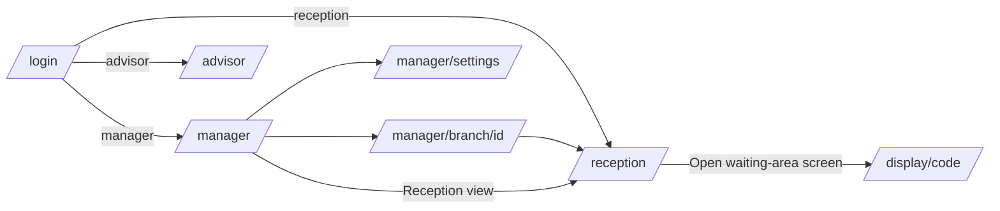
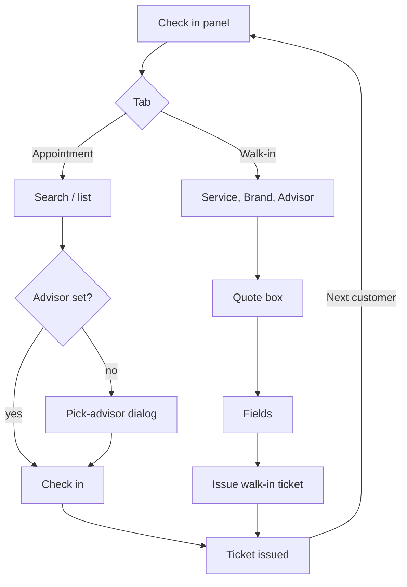
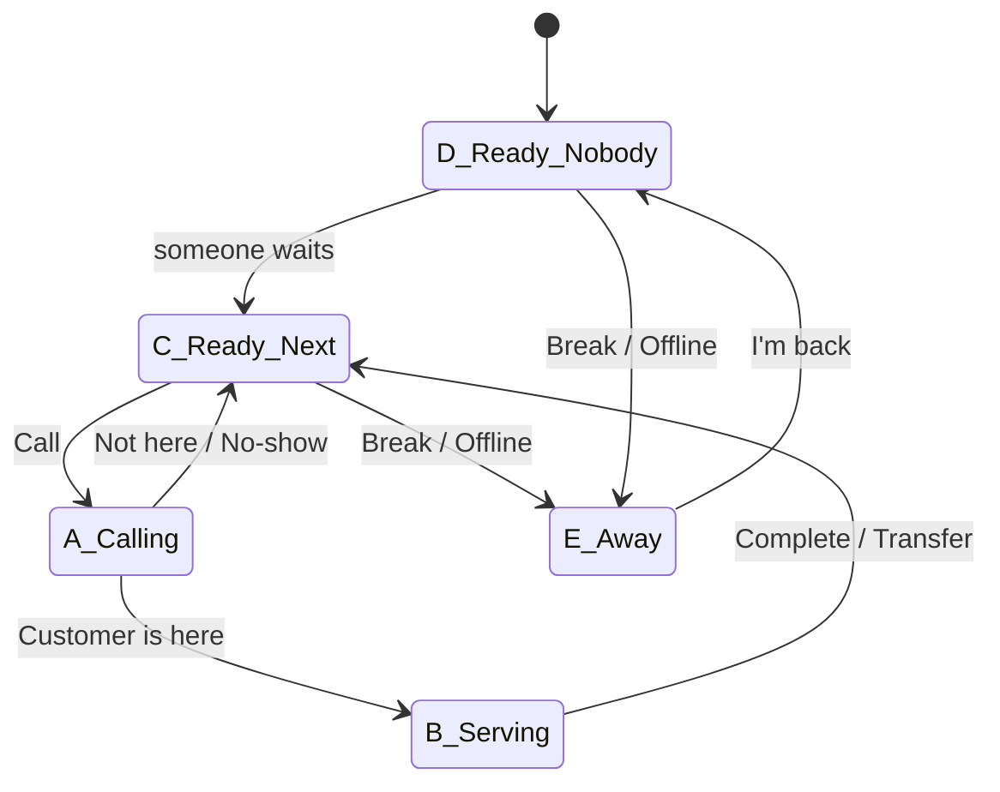

# AGMC Queue: Design system and layout spec

Companion to `docs/SPEC.md`. SPEC wins on **copy, colours and page content**. This file sets the **sizes, states, grids and motion**. Tokens live in `src/styles/tokens.css`. Use `var(--token)` and never hard-code hex values in components.

Ground rules: light mode only. Compact by default: never go above the sizes here. Every number here is in px unless it says otherwise. All numbers, times and timers use `font-variant-numeric: tabular-nums` (`.num`) so live values do not jitter.

---

## 0. Fonts

| Role | Family | Weights | Why |
|---|---|---|---|
| Everything | Pathway Extreme | 400 / 500 / 600 / 700 | AGMC house typeface |
| Ticket numbers, usernames, Keyloop refs, TV clock | **JetBrains Mono** | 500 / 700 | Clear `0`/`O` and `1`/`l`/`I`, which matters for A-014 and C-001. Tall x-height and open shapes stay readable at 64 px across a room. Its weight 700 matches the colour of Pathway Extreme 700. Free on Google Fonts. IBM Plex Mono was the runner-up, but it is narrower and looks lighter at TV size. |

Mono is always `font-variant-ligatures: none`. Ticket numbers are always 700.

---

## 1. Shared components

Focus ring for every interactive element: `outline: 2px solid var(--green); outline-offset: 2px`. On green surfaces (top bar, primary buttons, selected pills, the TV header) the ring is white. Rings appear only with `:focus-visible`.

Disabled for every control: `opacity: .45`, no hover change, `cursor: not-allowed`, plus `aria-disabled`. Use the native `disabled` attribute only when the control does not need a tooltip.

### 1.1 TopBar
`position: sticky; top: 0; z: --z-topbar; height: 58; background: --green; padding: 0 20; display: flex; align-items: center; gap: 0`.

| Part | Spec |
|---|---|
| Brand (link to role home) | White AGMC logo SVG, 22 tall (`src/assets/agmc-logo-white.svg`; until the asset arrives, use the white text "AGMC" at 18/700, tracking .04em). Then a divider 1 × 22 in `rgba(255,255,255,.3)` with 12 margin on each side. Then "Queue" at 16/700 in white. Focus ring is white. |
| Nav pills | Start 24 after the brand, with 6 gap between pills. Height 30, padding 0 14, radius pill, 13/600, white text, 1px `--on-green-line` border. Hover: bg `--on-green-hover`. **Active**: bg white, text `--green`, border white, `aria-current="page"`. |
| Branch picker (manager on /reception only) | Starts 16 after the nav. Select is 30 tall, min-width 200, radius 10, bg `--on-green-hover`, 1px `--on-green-line` border, white text 13/600, white chevron 12. The opened list is a standard Select menu (white). |
| Right group | `margin-left: auto; gap: 16`. The clock is 14/600 tabular in white. The user line is 13 in white: name 600, then " · role" at 400 with `opacity .85`, `max-width: 320`, ellipsis, and a `title` holding the full text. The **Sign out** pill is a nav pill at height 28 with padding 0 12. |
| At 1024 | Hide the role part of the user line (it stays in `title`). Nothing else changes. |

### 1.2 PageHeading
`margin: 20 0 16; display: flex; align-items: flex-end; justify-content: space-between; gap: 16`.
- Back link (optional, above the title): 12.5/600 `--green`, margin-bottom 4. Hover: underline.
- Title: `h1`, 24/700, lh 1.2, `--ink`.
- Sub line: 13/400 `--ink-2`, margin-top 2. Use **ink-2, not ink-3**, because ink-3 on the ground is only 4.36:1.
- Right slot: a link at 13/600 `--green` (hover underline, external links end in "↗"), or a control such as the advisor status switch.

### 1.3 Card
Background `--card`, 1px `--border`, radius 14, `--shadow-card`, padding 16.
Card header: `display: flex; align-items: baseline; gap: 8; margin-bottom: 12`. Title is `h2` at 17/700. Meta text (for example "3 waiting · in the order they will be called") is 12.5 `--ink-3`. Actions use `margin-left: auto`.
Sub-section label inside a card (for example ADVISORS AGAINST THE TEAM or QUEUE RULES): 11/700 uppercase, tracking .06em, `--ink-3`, margin 16 0 8.

### 1.4 KpiTile
A Card variant with padding 12 14 and min-height 84. Content is a vertical stack with a 4 gap.

| Part | Default | Clay state |
|---|---|---|
| Container | white, `--border` | bg `--clay-bg`, border `--clay-line` |
| Label | 11.5/600 `--ink-3`, lh 1.25, clamped to 2 lines | `--ink-2` (ink-3 on clay-bg is 4.07:1, which fails) |
| Value | 26/700, lh 1.1, tabular, `--ink` | `--clay` |
| Unit ("min", "%") | 13/600 `--ink-2`, 2 left margin, on the same baseline | `--clay` |
| Hint | 11.5/400 `--ink-3`, one line, ellipsis | `--ink-2` |

When the value is empty, show "—" in `--ink-3` with no unit. While loading, show "—" as well; do not use spinners inside tiles. Each tile is a `<div role="group" aria-label="{label}">`. The clay state adds the visually hidden text "needs attention".

Tile row: `display: grid; gap: 10; margin-bottom: 16`. Column counts are set per page (section 2).

### 1.5 Table
- `thead th`: height 32, padding 0 10, 11/700 uppercase, tracking .05em, `--ink-3`, border-bottom 1px `--border`, no background.
- `tbody td`: padding 8 10, `vertical-align: top`, border-bottom 1px `--border-soft`. The last row has no border.
  - Two-line cells (min row 44): first line 14/500 `--ink`, second line 12 `--ink-3` with margin-top 1.
  - Single-line tables (Settings, Activity, Audit, Sync history): row 36 and 13.5 text.
- Number columns are right-aligned and tabular. Ticket cells use TicketNumber `sm` (13/700 mono).
- Hover: row bg `--row-hover`, 120 ms.
- **Past told time row**: bg `--clay-bg` plus `box-shadow: inset 3px 0 0 var(--clay)` on the first cell. This beats hover, and hover leaves it unchanged.
- **Faint highlight row** (moved up / assigned): bg `--amber-tint`.
- **Faded row** (inactive advisor, checked-in appointment): bg `--row-hover`, all text `--ink-3`, chips keep their colours. Do not use `opacity`, because it would break contrast.
- Column widths in Reception Queue: # 28 · Ticket 72 · Customer 1fr (min 140) · Type 150 · Service 110 · Arrived 64 · Waiting 130 · Advisor 1fr (min 150) · ••• 40.
- Overflow: the table sits in a `div` with `overflow-x: auto` and `data-lenis-prevent`. It has a min-width (Queue 900, Settings tables 760), so it scrolls horizontally inside its card rather than squashing.

### 1.6 RowMenu (•••)
- Trigger: 28 × 28, radius 8, quiet. The glyph "•••" is 13/700 `--ink-2`. Hover: `--quiet-hover`. `aria-haspopup="menu"`, `aria-label="Actions for W-018"`.
- Menu: `role="menu"`, white, 1px `--border`, radius 10, `--shadow-pop`, padding 4, min-width 200, `z: --z-dropdown`, `data-lenis-prevent`. It opens bottom-end, 4 offset, and flips up if it would leave the viewport.
- Item: `role="menuitem"`, height 32, padding 0 10, radius 6, 13.5/500 `--ink`. Hover/focus: bg `--ground`. **Destructive** (for example "Cancel ticket…"): text `--clay`, hover bg `--clay-bg`. A 1px `--border-soft` separator with 4 margin goes above destructive items.
- Keyboard: Enter, Space or ArrowDown opens the menu and focuses the first item. ArrowUp opens it and focuses the last item. Up/Down move, wrapping. Home and End jump. Typing a letter jumps to the next item starting with it. Esc closes and returns focus to the trigger. Tab closes. Choosing an item closes the menu and opens its dialog.

### 1.7 Dialog
- Overlay: `--overlay`, `z: --z-overlay`. The page behind it does not scroll (`lenis.stop()` while open).
- Panel: `role="dialog" aria-modal="true" aria-labelledby aria-describedby`, white, radius 14, `--shadow-dialog`, padding 20. **Narrow** is 440 wide and **wide** is 640 wide. Width is `min(width, 100vw - 32)` and max-height is `100vh - 48`. The body scrolls (`data-lenis-prevent`) while the title and footer stay fixed.
- Title: 17/700. Explanation: 13 `--ink-2`, margin 4 0 16. Fields are a vertical stack with gap 12. Wide dialogs may use a 2-column field grid with gap 12.
- Footer: margin-top 20, `justify-content: flex-end`, gap 8. The safe choice (**Back** / **Cancel**, Quiet) comes first and the action comes last (Primary, or Destructive for no-show / cancel / reset).
- Focus: open on the first field. For dialogs with no fields (Mark no-show, Reset), open on **Back**. Focus is trapped, and on close it returns to the trigger. Esc and overlay click both close it. While the action is pending, the action button shows its pending state and Esc still works.
- Field errors appear inline under the field (clay, 12). Server rejections appear as a clay toast and the dialog stays open.

### 1.8 Toast
- Fixed at bottom 24, horizontally centred, `z: --z-toast`. Up to 3 stack with a gap of 8, newest at the bottom.
- Pill: radius pill, padding 9 16, min-height 38, max-width 520, 13.5/500, white text, `--shadow-toast`.
  - Success: bg `--ink`, auto-dismiss after **2.6 s**, `role="status"`.
  - Problem: bg `--clay`, auto-dismiss after **5 s**, `role="alert"`.
- The timer pauses on hover. A toast is not focusable and has no close button. The text is exactly as written in SPEC.

### 1.9 Chip (status pill)
Height 22, padding 0 8, radius pill, 11.5/600, `white-space: nowrap`, `display: inline-flex; align-items: center; gap: 5`. The dot variant has a 6 × 6 circle in `currentColor`.

| Variant | Text / Bg / Border | Used for |
|---|---|---|
| grey | `--ink-2` / `--grey-bg` / none | Booked, Cancelled, "in 28 min", "in 15′", Offline, Regular, Off, Source: mock |
| blue | `--blue` / `--blue-bg` | Waiting |
| amber | `--amber` / `--amber-bg` | Called, Calling, On break, "4 min late", "4′ late", "Late appt 11:00 · walk-in", Express |
| green | `--green` / `--green-bg` | Done, Available, Due now, "Appointment 12:30", Active |
| solid green | white / `--green` | With advisor, Serving |
| clay | `--clay` / `--clay-bg` | No-show, missed, "18 min late · walk-in", "Missed · joins as walk-in", Blocked |
| outlined | `--ink-2` / transparent / 1px `--grey-line` | Walk-in, the wait-promise example chips |
| role | grey | Manager / Reception / Service advisor on the demo accounts list |

Advisor-state chips always use the dot: Available (green), Calling (amber), Serving (solid green, white dot), On break (amber), Offline (grey).
**Soonest chip**: height 18, padding 0 6, 11/600, green variant, 6 gap after "Desk 5".

### 1.10 PlaceholderTag
Inline, height 18, padding 0 6, radius 4, 10.5/700 uppercase, tracking .06em, `--amber` text on `--amber-bg`, 1px `--amber-line` border. It sits 6 left of the text it flags, aligned to the middle. Text is **PLACEHOLDER** or **MOCK DATA**. The long tag "Placeholder · does Keyloop name one?" is the same tag with `text-transform: none` and 11/600. It never hides, including in the demo.

### 1.11 Banner
bg `--amber-bg`, 1px `--amber-line` border, radius 10, padding 10 14, 13/400 `--amber`, lh 1.45. Bold lead in 700. Optional 16 px info icon on the left with a 10 gap. Margin-bottom 16. `role="note"`.

### 1.12 Button
| Size | Height | Padding | Font |
|---|---|---|---|
| sm | 28 | 0 10 | 12.5/600 |
| md (default) | 34 | 0 14 | 13.5/600 |
| big | 44 | 0 20 | 15/600 |

All sizes have radius 10, an 8 gap between icon and label, and `white-space: nowrap`. `full` sets width 100%.

| Variant | Rest | Hover | Active |
|---|---|---|---|
| Primary | bg `--green`, white | `--green-hover` | `--green-press` |
| Secondary | white, 1px `--grey-line`, `--ink` | bg `--ground` | bg `--grey-bg` |
| Quiet (Back/Cancel) | transparent, `--ink-2` | bg `--quiet-hover`, `--ink` | bg `--grey-bg` |
| Destructive | white, 1px `--clay`, `--clay` | bg `--clay-bg` | bg `--clay-line` |
| Link | 12–13/600 `--green`, no padding | underline | — |

Pending state: the label stays and a 14 px spinner replaces the icon. The width is locked and `aria-busy="true"`. Disabled follows the global rule; the disabled Send SMS button carries a PlaceholderTag beside its label.

### 1.13 Segmented switch
Container: `role="radiogroup"`, `inline-flex`, padding 2, bg `--ground`, 1px `--border`, radius 10. Segment: `role="radio"`, height 28, padding 0 12, radius 8, 13/600 `--ink-2`. Hover (inactive only): `--quiet-hover`. Arrow keys move the selection and Tab enters only the checked segment.

| Instance | Active segment |
|---|---|
| Appointment \| Walk-in (Check in panel; full width, segments 50/50) | bg `--green`, white |
| Advisor status: **Available** | bg `--green`, white |
| **Break** | bg `--amber`, white (5.9:1) |
| **Offline** | bg `--ink-2`, white (9.2:1) |

Disabled segments while a customer is at the desk use the disabled style. A tooltip reading "Finish or transfer your customer first" appears on hover and on focus (the segments stay focusable with `aria-disabled`). Picking Break opens the Break dialog, and the segment only switches after **Start break**.

### 1.14 PillChoice
`role="radio"` (single choice: Service, Brand, Break reason) or `aria-pressed` (toggles: BRANDS, SERVICE TYPES). Height 30, padding 0 12, radius pill, 1px `--grey-line`, white, 13/500 `--ink`. Pills wrap with a 6 gap. Hover: border `--ink-3`. **Selected**: bg `--green`, border `--green`, white, 600. Focus ring is green with offset 2.

### 1.15 Switch
`role="switch" aria-checked`. Track 32 × 18, radius pill. Off: bg white with 1px `--line-input`, thumb `--line-input`. On: bg `--green`, white thumb. Thumb is 14, inset 2, travel 14, `--dur-base` with `--ease-out`. Label is 13.5 `--ink`, 8 to the right. An optional state word ("On"/"Off", "Simulator"/"A person") is 12.5 `--ink-2`.

### 1.16 Inputs and Select
- Label: 12/600 `--ink-2`, margin-bottom 4, and always a visible `<label for>`.
- Field: height 34, padding 0 10, radius 10, white, 1px `--line-input`, 14 `--ink`. Placeholder is `--ink-3`. Hover: border `--ink-3`. Focus: border `--green` plus the 2 px ring. Error: border `--clay`, message 12 `--clay` margin-top 4, linked with `aria-describedby`.
- Locked (Code/Username after creation): bg `--row-hover`, text `--ink-2`, `readonly`, with a hint saying it is locked.
- Number box (queue rules): width 72, right-aligned, tabular. Time box (22:00): width 80, mono.
- Textarea (Note): min-height 64, padding 8 10, `data-lenis-prevent`.
- Search: 14 px magnifier icon at the left (padding-left 32) and a clear "×" button when it has a value.
- Select: same box with a 12 px chevron at right 10. The menu is white, radius 10, `--shadow-pop`, max-height 280, `data-lenis-prevent`, and options are 32 tall.

### 1.17 ProgressBar
Track `--grey-bg`, radius pill, fill `--green` (over expected: `--clay`), and the width transitions over 300 ms linear. Height 4 on advisor cards and 6 on the serving timer. `role="progressbar"` with `aria-valuenow`/`max` in seconds and `aria-valuetext="13 of 25 minutes"`.

### 1.18 TicketNumber
`<span class="mono">` at weight 700, `--ink`, letter-spacing −0.01em at 44 and above.
Sizes: `sm` 13 (tables, lists) · `md` 16 (Your line, Next for you meta) · `lg` 44 (advisor desk, ticket issued) · `tv` 64. On TV green rows the colour is white.

### 1.19 EmptyState
Text exactly as SPEC, 13.5 `--ink-3`, centred, padding 24 16 inside the card body, no illustration. In green-tinted lists, use `--ink-2`.

### 1.20 Loading
- Page: "Loading…" at 13.5 `--ink-3`, centred, 120 below the top bar. It shows only after **150 ms** so it does not flash. The TopBar renders right away.
- In a card: the same text inside the card body, which has a min-height of 120 so the layout does not jump.
- KPI tiles show "—". Charts show the card shell plus "Loading…".

### 1.21 AdvisorBar
Bar height 6, radius pill, `overflow: hidden`, flex. Segment widths are proportional to the counts, with 1 px white gaps between them. Colours: Free `--bar-free` (#2F6B1A), Busy `--bar-busy` (ink), Break `--bar-break` (ochre), Offline `--bar-offline` (light grey). A zero count means no segment. The legend sits above the bar on the right: 8 × 8 squares (radius 2) with "Free 1" in 12 `--ink-2`, 12 apart. The bar carries `aria-hidden`, because the legend text is the accessible version.

### 1.22 Tooltip
Dark: bg `--ink`, white 12/500, radius 8, padding 5 8, max-width 260, `z: --z-tooltip`. It appears after 400 ms on hover and right away on focus, and Esc dismisses it. `role="tooltip"` is linked with `aria-describedby`.

---

## 2. Page layouts

App shell: TopBar, then `main` with `max-width: 1600`, `margin: 0 auto` and `padding: 0 24 40`. Breakpoints: **≥1360** wide, **1100–1359** mid, **1024–1099** laptop. Below 1024, desktop pages show a horizontal scrollbar on the body rather than reflowing. Sign in is the exception and is responsive down to 360.

### 2.1 Sign in (/login)
```
≥ 768                                         < 768
+-------------------+------------------------+  +---------------------------+
| deep-green 44%    | ground 56%             |  | deep-green band, pad 20 16|
| (min 420)         |  form col 360 centred  |  | logo 18 · headline 20/700 |
| logo   pad 40     |  Sign in 24/700        |  +---------------------------+
|                   |  sub + PLACEHOLDER     |  | form pad 24 16 (full w)   |
| Headline 32/700   |  Username / Password   |  | demo accounts             |
| line 15 / .82 op  |  [ Sign in  full big ] |  | © 2026 AGMC · Prototype   |
|                   |  DEMO ACCOUNTS …       |  +---------------------------+
| © footer 12 /.6   |                        |
+-------------------+------------------------+
```
- Brand panel: bg `--deep-green`, padding 40, flex column. The logo is white and 26 tall. The headline sits in the vertical middle: 32/700, lh 1.15, white, max-width 440. The line is 15/400, white at opacity .82, max-width 440, margin-top 12. The footer is 12 white at opacity .6.
- Form column: vertically centred, 360 wide. Title is 24/700. The sub line is 13 `--ink-2` with a PlaceholderTag, margin-bottom 20. Fields are 34 tall with a 12 gap. **Sign in** is primary big full-width, margin-top 16. The error "Wrong username or password" is 12.5 `--clay`, margin-top 8, `role="alert"`, and both fields get the clay border.
- Demo accounts: margin-top 28, then a 1px `--border` top rule with padding-top 16. The title is 11/700 caps, tracking .06em, `--ink-3`. Group headings are 11.5/600 `--ink-3` with margin 10 0 4. Each row is a `<button>` 44 tall, padding 0 10, radius 10, full width, laid out as a grid of `1fr auto`. The name is 13.5/700, then the username in mono 12 `--ink-3` at margin-left 6, then a role chip. Hover: bg white plus `--shadow-sm`. The list scrolls within the viewport on short screens (`data-lenis-prevent`).
- On a phone the description line is hidden; the logo and headline remain. The footer moves under the demo list.

### 2.2 Reception (/reception)
```
TopBar 58
PageHeading                                      Open waiting-area screen ↗
[KPI x9 ................................................................]
+-- Check in 390 (sticky) --+  +-- wide 1fr ----------------------------+
| Check in                  |  | Queue  3 waiting · …                    |
| [Appointment | Walk-in ]  |  | table                                   |
| tab body (scrolls inside) |  +-----------------------------------------+
|                           |  | Advisors  8 of 9 present                |
|                           |  | card grid                               |
|                           |  +--------------------+--------------------+
|                           |  | Appts not arrived  | Recently finished  |
+---------------------------+  +--------------------+--------------------+
```
- KPI row: `repeat(9, minmax(0,1fr))` at ≥1360 (about 163 per tile at 1600 and 146 at 1440). At 1024–1359 it becomes `repeat(5, 1fr)`, wrapping 5 + 4 with the last cell empty. Labels may wrap to 2 lines, and min-height 84 keeps the tiles even.
- Columns: `grid-template-columns: 390px 1fr; gap: 16; align-items: start`. The wide column is a stack with a 16 gap. Appointments not arrived and Recently finished sit in `1fr 1fr` at ≥1280 and stack below that.
- Check in panel: `position: sticky; top: calc(58px + 16px)`, `max-height: calc(100vh - 58px - 32px)`, flex column. The switch sits under the title (full width, margin 0 0 12). The tab body is `overflow-y: auto; data-lenis-prevent`.
- **Appointment tab**: search (full width), then the hint line (12 `--ink-3` + MOCK DATA tag, margin 6 0 8), then the list. Each row is padding 10 0 with a border-bottom in `--border-soft`, laid out as a grid `52px 1fr auto` with gap 10.
  - Col 1: slot time 17/700 tabular.
  - Col 2: name 14/600, then "Dubai X 75542 · BMW X6 M60i" 12 `--ink-2`, then "Service · Layla Mansour (allocated)" 12 `--ink-3`, then the status chip (margin-top 4).
  - Col 3, right-aligned stack with gap 4: **Check in** (Primary sm), then "change advisor" (link 12). Checked-in rows are faded: col 3 shows TicketNumber sm plus its status chip in place of the buttons.
- **Walk-in tab**: SERVICE, BRAND and ADVISOR labels are 11/700 caps, tracking .06em, `--ink-3`, margin 14 0 6 (the first has margin-top 0).
  - Advisor rows: `role="radiogroup"`, each row a `role="radio"` 38 tall, padding 0 10, radius 10, 1px `--border`, 6 gap between rows. The layout is a grid `1fr auto`: left "**Ravi Menon** · Desk 5" 13.5 plus the Soonest chip, right "about 15 min" 13 `--ink-2`. Hover: border `--grey-line`. Selected: border `--green`, `box-shadow: inset 0 0 0 1px var(--green)`, bg `--green-tint`.
  - Quote box: margin-top 12, radius 10, padding 12 14, bg `--green-tint`, 1px `--green-line`. Contents in order:
    1. "Tell the customer" 12/600 `--ink-2`
    2. "About 15 min" 26/700 `--green`, lh 1.15, margin 2 0 4
    3. "**Ravi Menon** will see them · called by **12:56**" 13 `--ink`
    4. Forecast line 11.5 `--ink-2`, margin-top 6
    5. Warnings 12.5/600 `--clay`, margin-top 6
  - The clay variant (wait ≥30 min, or "No advisor can take this now") uses bg `--clay-bg`, border `--clay-line`, and turns the big text `--clay`.
  - Fields: grid `1fr 1fr`, gap 10, margin-top 14. Note spans both columns. **Issue walk-in ticket** is primary big full-width, margin-top 14.
- **Ticket issued** (replaces the switch and tab body): centred and stacked.
  1. TICKET ISSUED: 11/700 caps, tracking .1em, `--ink-3`
  2. TicketNumber lg, margin 4 0
  3. Name 16/700
  4. "Service · BMW" 13 `--ink-2`
  5. Tell-them line: 14 `--ink` in a green-tint box (radius 10, padding 10 12, margin 12 0, left-aligned)
  6. Late line (when it applies): 12.5/600 `--clay`
  7. Row `1fr 1fr`, gap 8: **Print ticket** (Secondary) · **Send SMS** (Secondary, disabled, PLACEHOLDER)
  8. **Next customer** primary big full-width, margin-top 8
- **Queue**: Table (§1.5). Under the Type chip, "Moved up: …" is 12 `--amber` and "Assigned → Omar Haddad" is 12 `--ink-2`.
  - Waiting cell, walk-ins: "7 min" 14/600 in `--ink`; `--amber` within 3 min of the cap; `--clay` at the cap. "told by 12:49" is 12 `--ink-3`. "6 min past told time" is 12/700 `--clay`.
  - Advisor cell: name 14/600. "est. 12:42" is 12 `--ink-3`, the covering text is 12 `--amber`, and "No advisor available" is 12/600 `--clay`.
- **Advisors**: `grid-template-columns: repeat(auto-fill, minmax(220px, 1fr)); gap: 10`. Each advisor card has radius 10, 1px `--border`, padding 10 12, and min-height 88.
  - Row 1: name 14/700 with the state chip on the right.
  - Row 2: desk line 12 `--ink-3`.
  - Row 3 (margin-top 8): "A-021 Fatima Haddad 33′ / 33′" 12.5, with the ticket in mono 700 and the times right-aligned tabular, then a 4 px ProgressBar at margin-top 6. Without a customer, this row is the status text at 12.5 `--ink-2`.
  - Shaded cards (break/offline) use bg `--row-hover` and a name in `--ink-2`.
- **Appointments not arrived / Recently finished**: Cards with the count in the meta. The list is `max-height: 320; overflow-y: auto; data-lenis-prevent`. Each line is 36 tall, laid out as a grid `48px 1fr auto` with gap 10: time 13/600 tabular, then the text (main 13 + secondary 12 `--ink-3` on one line, separated by " · ", with ellipsis), then the chip.

### 2.3 Advisor desk (/advisor)
- PageHeading: the status switch sits in the right slot.
- KPI: `repeat(4, 1fr)`, gap 10.
- Columns: `1fr 380px`, gap 16, `align-items: start`. Left is a stack with gap 16: Current customer, then Your line (only when someone is waiting). The right column (My day) is sticky at `top: 74`, with its list scrolling inside (`max-height: calc(100vh - 58px - 32px - 60px)`, `data-lenis-prevent`).

**Current customer card**: padding 20, min-height 260 so the card does not jump when the state changes. Hierarchy: **ticket 44 > timer 36 > name 22 > everything else.**
```
CALLING TO DESK 1                       (11.5/700 caps .08em, colour per state)
A-014   Aisha Khan   [Appointment 12:30]  ticket lg · name 22/700 · chip; gap 16, align baseline
Called 0:42 ago · called 2 times. …     13 --ink-2, margin-top 6
---------------------------------------- 1px --border-soft, margin 14 0
MOBILE   PLATE   VEHICLE   SERVICE      details grid: repeat(4,1fr), gap 12 16
ARRIVED  WAITED  KEYLOOP REF  EXPECTED  label 10.5/700 caps .06em --ink-3; value 14/500
[Customer is here — start] [Call again] [Not here — back to queue] [No-show]
```
| State | Status line colour | Body | Buttons (margin-top 16, gap 8, wrap) |
|---|---|---|---|
| A Calling | `--amber`, pulsing (§3) | hero row, called line, details | Primary big · Secondary big · Secondary md · Destructive md |
| B Serving | `--green` | hero row; timer row "13:00" mono 36/700 tabular + " / 25:00 expected" 14 `--ink-2`; a 6 px ProgressBar at margin 8 0 0. Over expected turns the timer and bar `--clay`. Then details, then the notes box (bg `--ground`, radius 10, padding 10 12, 13 `--ink-2`), then the Note textarea (label 12/600). | **Complete** Primary big · **Transfer…** Secondary big |
| C Ready, next | `--green` "READY" | "Next for you" 12.5/600 `--ink-3`, hero row, reason line 13 `--ink-2` | **Call A-021** Primary big |
| D Ready, nobody | `--green` "READY" | "Nobody is waiting for you." 22/700, then a line 13.5 `--ink-2` (max-width 560) | — |
| E Break/Offline | `--amber` (break) or `--ink-2` (offline) | "Enjoy your break." / "You're not taking customers." 22/700, then a line 13.5 `--ink-2` | **I'm back — available** Primary big |

At 1024 the details grid stays at 4 columns (left column is about 580). The hero row wraps the chip under the name when space runs out.

**Your line**: Table, Ticket cell = TicketNumber sm plus the chip stacked under it with a 4 gap. **My day**: lines with a grid `44px 1fr auto` and gap 10, padding 8 0, border-bottom `--border-soft`. The footer line is 12 `--ink-3` with a top rule and margin-top 10.

**Break dialog**: narrow. Reason pills are a PillChoice radiogroup with Coffee preselected. **Start break** is Primary.

### 2.4 Manager overview (/manager)
- KPI: `repeat(7, minmax(0,1fr))` at ≥1200 and `repeat(4, 1fr)` below (4 + 3).
- Branch cards: `repeat(2, 1fr)`, gap 16 at ≥1100, and 1 column below. Each card is a Card with padding 16.
  1. Header: name 17/700. The sub line is 12.5 `--ink-3` and ends with "· inactive" in `--clay` when it applies. "Dashboard →" is link 13 on the right.
  2. Figures: `grid-template-columns: repeat(4, 1fr); gap: 12 10; margin: 14 0`, in a box with bg `--ground`, radius 10, padding 12. Labels are 11/600 `--ink-2` (the ground background rules out ink-3). Numbers are 20/700 tabular, `--ink`, or `--clay` when they need attention.
  3. Advisors: the label "Advisors" 12/600 `--ink-2` with the legend on the same line on the right, then the AdvisorBar at margin-top 6.
  4. Attention list: margin-top 14. Items are 12.5 `--clay`, padding 5 0 5 12, with a 6 px clay dot at the left and a 4 gap. At most 5 items. When empty, show one line in 12.5/600 `--green` with a green dot: "Nothing needs attention".
  5. Footer: a 1px `--border-soft` top rule, padding-top 10, margin-top 12, links 12.5/600 with an 16 gap.
- Inactive branch card: the header sub line uses the clay "inactive" and the figures box has opacity 1, so the card is not faded.

### 2.5 Branch dashboard (/manager/branch/:id)
- KPI: same grid as the overview (7).
- Panels: `grid-template-columns: 1fr 1fr; gap: 16` at all supported widths (about 480 each at 1024). The order is Arrivals by hour · Average wait by hour / Desk time by service type · Advisors today.
- Learned section: section title `h2` 17/700 plus a meta line at margin 24 0 12, then `1fr 1fr` panels, then Activity (full width) at margin-top 16.

**Chart styling** (all charts; SVG, built to these values):
| Element | Spec |
|---|---|
| Plot height | 200 (wait-promise columns: 160). Padding: left 32 (y labels), bottom 22 (x labels), top 18 (value labels) |
| Legend | Above the plot, right-aligned, margin-bottom 8. Swatches are 10 × 10 radius 2; text is 12 `--ink-2` with 12 between items. The cap swatch is a 14 × 0 dashed 1.5 px clay line. |
| Gridlines | Horizontal only, 1px `--border-soft`, 4–5 nice ticks. No vertical lines. |
| Axes | The x baseline is 1px `--border`. There is no y axis line. Tick labels are 11 `--ink-3` tabular; x labels "07"…"17" are centred under their column. |
| Columns | Band 100% / 11 hours, bar width 60% of the band, top corners radius 3 (only the top segment of a stack is rounded). Stack order is appointments (`--chart-appt`) at the bottom and walk-ins (`--chart-walk`) on top, with a 1px white separator. |
| Average wait bars | `--chart-appt` |
| Cap line | Full-width horizontal line at y = cap, 1.5 px `--clay`, dashed 4 3, labelled at the right end "Walk-in cap 15 min" in 11/600 `--clay`, 4 above the line |
| Horizontal bars (desk time) | Rows 32 apart, bar height 16, radius 0 3 3 0, `--chart-appt`. The service label sits on the left in a 84 column, 12.5 `--ink`. The value at the bar end ("33′") is 12/600 `--ink` and turns `--clay` when over. The configured tick is 2 × 24, `--ink`, centred on the bar. |
| Wait-promise columns | 6 columns: 3 `--chart-appt` then 3 `--chart-walk`. The count above each is 12/600 `--ink`. Never put text in the ochre. The x labels (11 `--ink-3`) may wrap to 2 lines. |
| Hover | Bands are the hit area. The hovered column gets an `--ink` 4% overlay, and the tooltip (§1.22) sits above the bar 8 offset with text exactly as SPEC. Bands are also focusable (`tabindex=0`, arrow keys move between them) and show the same tooltip. |
| a11y | `<svg role="img" aria-label="Arrivals by hour, 07 to 17">` plus a visually hidden `<table>` of the same data |
| Empty | Axes stay and the plot area shows "No finished visits yet" centred in 13.5 `--ink-3` |

- Big figure "83%" (Wait promises): 36/700 `--green`. Example chips are outlined.
- Desk times table: "Now using" is clay when it applies. The sub-line "BMW 32′ · BMWi 31′ · MINI 33′" is 12 `--ink-3`. The footnote is 11.5 `--ink-3`.
- Activity: compact table; the Who column is mono 12.5.

### 2.6 Settings (/manager/settings)
- `grid-template-columns: 220px 1fr; gap: 20; align-items: start`.
- Tab list: `role="tablist" aria-orientation="vertical"`, sticky at top 74, as a Card with padding 6. Each tab is 34 tall, padding 0 12, radius 10, 13.5/500 `--ink-2`, left-aligned. Hover: `--quiet-hover`. **Selected**: bg `--green`, white 600, `aria-selected`. Up/Down arrows move the selection and Home/End jump.
- Content: a stack with a 16 gap (Banner, then Cards). The card header holds "+ Add…" as Primary sm on the right. Filters (branch Select, width 200, height 28) sit to the left of the add button with an 8 gap.
- Tables use compact rows (36). The **Edit** cell is a Secondary sm button in the last column (width 64). Inactive rows are faded (§1.5).
- Branch dialog (wide): Code / Name are 2 columns, Opens / Closes are 2 columns (time inputs, 80 wide each), then the Active switch.
  - Each QUEUE RULES row is a grid `1fr 72px`, gap 16, padding 10 0, border-bottom `--border-soft`. The name is 13.5/700, the explanation is 12 `--ink-2` at lh 1.4, and the number box is aligned to the top.
- Keyloop card: the inline sentence holds a time box (80) and **Save** (Secondary sm), aligned to the middle.
- Demo tab: **Reset today's demo data** is Destructive md and opens a narrow confirm dialog with **Back** and a destructive action.

### 2.7 Waiting-area TV (/display/:code), fixed 1920 × 1080
`overflow: hidden`, no Lenis, no scroll reveal, `cursor: none` after 3 s idle. Everything scales from 1920 × 1080: wrap the stage in `transform: scale(min(vw/1920, vh/1080))` so other screen sizes letterbox on `--ground`.

```
+--------------------------------------------------------------------------+ 0
| HEADER 96  green  pad 0 48  logo 40h · divider 1x40 · branch 28/600      |
|                                                     clock mono 56/700    |
+--------------------------------------------------------------------------+ 96
| pad 40 48 0                                                              |
| LEFT 1184                                 gap 48 | RIGHT 592             |
| NOW CALLING  (22/700 caps .12em ink-2, mb 16)    | NEXT                  |
| [ A-014                       → Desk 2 ] 112h    | [A-022][W-019]  2 col |
| [ W-017                       → Desk 5 ]         | [W-020][A-023]  72h   |
| … max 4 rows, gap 12                             | … up to 10 tiles      |
| AT THE DESKS (mt 40, mb 16)                      | 3 waiting  56/700     |
| [W-015 Desk 1][A-012 Desk 2][..][..] 4 col, 80h  | grey line 22 ink-2    |
+--------------------------------------------------------------------------+ 1016
| FOOTER 64  rule 1px --border  pad 0 48  20/500 ink-2   left · right      |
+--------------------------------------------------------------------------+ 1080
```
- Header: bg `--green`, all white. The branch text is "Main Branch (SZR) · Service reception" at 28/600. The clock is JetBrains Mono 56/700 tabular.
- **NOW CALLING row**: height 112, radius 14, padding 0 40, flex with space-between, white bg, 1px `--border`, `--shadow-card`. The ticket is mono **64**/700 `--ink`. "→ Desk 2" is 48/700 `--green`. **New call (≤20 s)**: bg `--green`, border `--green`, and both texts white. At 20 s it fades to the white row over 600 ms. Rows are newest first and at most **4** are visible; older calls drop off the bottom.
- Empty row: same 112 row, bg `--grey-bg`, no border, "Please wait — you will be called shortly" at 36/500 `--ink-2`, left-aligned.
- AT THE DESKS: `repeat(4, 1fr)`, gap 12, at most 3 rows (12 tiles; extras hidden). Each tile is 80 tall, radius 14, white, 1px `--border`, padding 0 24, flex with space-between: ticket mono 32/700 `--ink`, "Desk 1" 26/600 `--ink-2`.
- NEXT: `repeat(2, 1fr)`, gap 12, tiles 72 tall, radius 14, white, 1px `--border`, ticket mono 36/700 centred, in queue order reading row-major. Then "3 waiting" at 56/700 `--ink` with margin-top 32, and the explanatory line at 22/400 `--ink-2`, lh 1.4, max-width 520.
- Footer: "Please keep your ticket number ready." on the left and "AGMC Aftersales" on the right.
- Legibility minimums: nothing on the TV is under 20 px, ticket text is ≥32 px, and every text pairing is ≥7:1 except `--ink-2` on `--grey-bg` (7.8:1).
- Not found: the full stage on `--ground`, with header (logo only) and footer. Centred "Screen not available: <reason>" at 36/600 `--ink-2`.
- Loading: header and footer, with "Loading…" at 28 `--ink-3` centred.
- Lost connection to the store (BroadcastChannel silent >10 s): keep the last data. The clock keeps ticking and a 10 px `--amber` dot appears beside it. No copy is added.

### 2.8 States per screen

| Screen | Loading | Empty | Error |
|---|---|---|---|
| Sign in | Button pending state | — | "Wrong username or password" inline (clay) + both fields clay; access messages as a clay toast after redirect |
| Reception | Page "Loading…"; tiles "—" | Queue: "Nobody waiting"; search: "No appointment matches"; not arrived: "None left today"; finished: "Nothing yet"; advisors: no card (meta "0 of 9 present") | Action failures as a clay toast (SPEC list); "Not your branch" / "Your role cannot open this" as a full-page message (below) |
| Advisor desk | Page "Loading…" | My day: "Nothing booked for you today"; Your line hidden; State D card | Clay toasts; "This account is not linked to an advisor" as a full-page message |
| Manager overview | Page "Loading…" | Attention: "Nothing needs attention" | Clay toasts |
| Branch dashboard | Card shells + "Loading…" | Charts and learned panels: "No finished visits yet" | Clay toasts |
| Settings | Content-area "Loading…" | Tables keep the header; the body row shows "—" in ink-3 | Inline field errors + clay toast, with the dialog kept open |
| TV | §2.7 | Empty calling row | "Screen not available: <reason>" |

Full-page message (access errors): Card, max-width 440, centred, margin-top 80. The text is 15/600 `--clay` with exactly the SPEC message, plus a Primary md button that links to the role's home ("Queue"/"My desk"/"Overview", reusing nav labels). For "Please sign in again." the redirect goes to /login and a toast shows.

---

## 3. Motion

Easing is `--ease-out` = `cubic-bezier(0.16, 1, 0.3, 1)` unless noted. Under `prefers-reduced-motion: reduce`, everything below becomes an instant state change (tokens.css zeroes durations): no pulses, no movement, and Lenis lerp is 1.

| Animation | Spec | Reduced motion |
|---|---|---|
| CALLING pulse (advisor status line, Calling chip optional) | `opacity 1 → .55 → 1`, 1600 ms, `--ease-in-out`, infinite, text only (no scale) | Static, opacity 1 |
| TV new-call pulse | On insert, the row is `--green`. `box-shadow: 0 0 0 0 → 0 0 0 16px rgba(21,56,4,0)` together with `filter: brightness(1) → 1.25 → 1`, 1200 ms, **3 iterations**, then static green. At 20 s it fades to white over 600 ms. The row slides in `y -24 → 0` over 400 ms and the others shift down over 400 ms. | Static green row appears; it turns white at 20 s with no fade |
| Toast | In: `opacity 0→1, y 12→0`, 200 ms. Out: `opacity →0, y →8`, 150 ms, ease-in | Instant |
| Dialog | Overlay opacity 0→1 over 200 ms. Panel `opacity 0→1, scale .97→1, y 8→0` over 200 ms. Out is the reverse over 150 ms. | Instant |
| Row menu / select | `opacity 0→1, y -4→0`, 120 ms | Instant |
| Scroll reveal (`motion` `whileInView`, `viewport={{ once: true, amount: 0.15 }}`) | Cards only: `opacity 0→1, y 8→0`, 320 ms, stagger ≤40 ms, at most 6 items. **Never** on table rows, list rows, KPI values or the TV. On Reception and the Advisor desk it runs on first mount only, never on live updates. | Disabled |
| Hover / press | Colour and background over 120 ms | Instant |
| Live value change | No animation, so numbers swap in place (tabular figures keep the width) | — |

Lenis is configured at the app root with `{ lerp: 0.1, smoothWheel: true }` (lerp 1 for reduced motion). `data-lenis-prevent` goes on dialogs, menus, selects, the Check in tab body, the inner lists, table scrollers and textareas. Use `lenis.scrollTo` for in-page jumps. Lenis is skipped on /display.

---

## 4. Accessibility

### 4.1 Contrast (WCAG 2.2, computed)
| Pair | Ratio | Use | Verdict |
|---|---|---|---|
| ink on white / ground | 18.3 / 16.6 | body | AAA |
| ink-2 on white / ground | 9.2 / 8.3 | secondary text, page sub line | AAA |
| ink-3 on white | 4.8 | hints, labels, table headers | AA (white surfaces only) |
| ink-3 on ground | **4.36** | — | **Fails: do not use** (use ink-2) |
| ink-3 on clay-bg / green-tint | 4.1 / ≈4.4 | — | **Fails: use ink-2** |
| white on green | 13.1 | top bar, primary, solid chips, TV | AAA |
| green on white / ground | 13.1 / 11.9 | links, TV desk | AAA |
| green on green-bg | 11.1 | green chips | AAA |
| white on deep-green | 16.5 | sign-in hero | AAA |
| clay on white / clay-bg | 7.6 / 6.5 | warnings, clay chips, clay KPI | AA+ |
| white on clay | 7.6 | problem toast | AAA |
| amber on white / amber-bg | 5.9 / 5.3 | calling, placeholder, banner | AA |
| white on amber | 5.9 | Break segment | AA |
| blue on blue-bg | 7.4 | Waiting chip | AAA |
| ink-2 on grey-bg | 7.8 | grey chips, TV empty row | AAA |
| white on ink-2 | 9.2 | Offline segment | AAA |
| white on ink | 18.3 | success toast, tooltip | AAA |
| chart-appt on white | 6.5 | bars | ≥3 graphic |
| chart-walk on white | 3.2 | bars only | ≥3 graphic; **never text** |
| line-input on white | 3.4 | input borders, switch-off | 1.4.11 pass |
| on-green-line on green | ≈5 | nav pill outline | pass |

Colour is never the only signal. Clay rows also carry text ("6 min past told time"). Clay KPI tiles add a visually hidden "needs attention". Chips always have words. Chart colours carry a legend, and the pairing passed the colour-blind check (SPEC).

### 4.2 Keyboard and semantics
- Tab order follows visual order: TopBar, then heading, then KPI tiles (not focusable), then the left column, then the right column. A "Skip to content" link (visually hidden until it has focus, at top-left 8 of the TopBar) jumps to `main`.
- Dialogs: focus trap, Esc closes, and focus returns to the trigger (§1.7). Menus: §1.6. Segmented switch and pill groups: radiogroup with arrow keys. Settings tabs: vertical tablist.
- Live regions: toasts as above. The Reception queue count and the advisor status line sit in a polite `aria-live` region that announces only state changes ("Calling A-021"), never ticking timers. Timers carry `aria-hidden` on the ticking text, plus an `aria-label` refreshed once a minute.
- Every icon-only button has an `aria-label`. Tables use `<th scope="col">`. Each chart has a hidden data table.
- Hit targets: at least 28 × 28 (sm buttons, row menu), and 34 for most controls. The 24 × 24 WCAG 2.5.8 minimum is met everywhere.
- Text resizes to 200% without loss. Dialog bodies and the Check in panel scroll internally.
- The TV is passive (no interaction) and must not flash more than 3 times per second; the pulse is 0.83 Hz.

---

## 5. User flows






